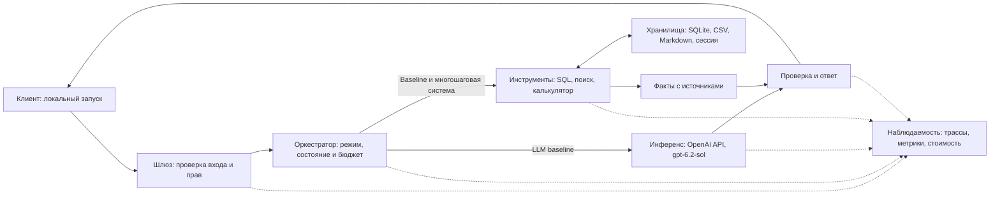

# Design doc: LLM-система для аналитики по структурированным и неструктурированным корпоративным данным

Основан на шаблоне команды [Reliable ML](https://github.com/IrinaGoloshchapova/ml_system_design_doc_ru/blob/main/ML_System_Design_Doc_Template.md) и на [design doc курса «Современные методы NLP»](https://github.com/xufana/modern_nlp_llm/blob/main/hw/hw_01.md).

| Поле | Значение |
|---|---|
| Авторы | Рагимов И.Р, Рагимов Ф.Р, Ефремов Д.А |
| Версия | 0.5 |
| Статус | Черновик КТ3 |
| Обновлён | 23.11.2026 |
| ADR | [001. Фиксированные многошаговые маршруты](adr/001-fixed-workflows.md) |

## Как пользоваться шаблоном

На КТ2 подготовлены синтетический корпус и видимый eval-сет из 45 вопросов, описаны метрики, процедура получения ground truth, baseline, план усложнений и обновлённые риски. КТ3 добавляет локальный харнесс, исполняемые маршруты и измерения на видимой части корпуса. Цели пилота заданы в §3, фактические измерения локального запуска приведены в §8.1.

## 1. Контекст проекта

Для учебного пилота выбираем аналитику вымышленного B2B-сервиса управления задачами и проектами. Сервис продаёт компаниям подписки на тарифы Basic, Pro и Enterprise. Пользователями LLM-системы являются внутренние сотрудники сервиса. Компании-подписчики выступают объектами анализа и не получают доступ к LLM-системе. Корпус пилота составим из SQL-данных о клиентах, подписках, платежах и обращениях в поддержку и текстовых документов с условиями тарифов, SLA и описаниями релизов. Вопросы §7.1 будут проверяться на этом корпусе.


### 1.1 Бизнес-задача

- **Проблема.** Корпоративная информация распределена между источниками: числовые и событийные данные находятся в SQL-базе, а условия тарифов, правила и история изменений продукта находятся в документах. Для ответа на бизнес-вопрос сотруднику приходится искать информацию и обращаться к аналитику.
- **Почему использовать LLM.** Поиск по документам не выполняет анализ SQL-данных, а готовый SQL-запрос не объясняет связанный с показателем бизнес-контекст. LLM может интерпретировать вопрос на естественном языке и определить, какие источники нужны. Полезность такого подхода необходимо проверить, сравнив его с более простыми решениями.
- **Почему решение имеет смысл.** Система объединяет получение числовых данных, поиск документов и расчёты. Пользователь получает ответ с источниками и не обязан знать SQL.
- **Критерии успеха с точки зрения бизнеса.** Основной показатель пилота - доля вопросов в пределах подключённых данных, по которым пользователь подтвердил, что ответ решил задачу без помощи аналитика. После ответа пользователь отмечает «Принято» или «Нужна проверка»; событие сохраняется в журнале вместе с вопросом. Через сутки уточняем, обращался ли он к аналитику. В числитель входят только принятые ответы без такого обращения, цель - не менее 50%. Медианное время до подтверждения отслеживаем отдельно, цель - не более 10 минут. Эти значения пока не измерены.

**Альтернатива без системы:** аналитик, самостоятельная работа с SQL/BI/Excel или отказ от анализа. Для предварительного сравнения принимаем условные 30 минут работы аналитика на типовой вопрос и стоимость часа 1 500-3 000 ₽. Тогда один ответ стоит 750-1 500 ₽ рабочего времени. Это расчётное допущение для КТ1, а не измеренная стоимость в конкретной компании.

При условных 400 вопросах в месяц из §1.2 ручная обработка всех заняла бы 200 часов и стоила бы 300 000-600 000 ₽ рабочего времени. Это не ожидаемая экономия: часть вопросов потребует проверки, а затраты на создание и поддержку системы здесь не учтены.

### 1.2 Пользователи и сценарии использования

- **Кто.** Внутренние заказчики аналитики B2B-сервиса управления задачами и проектами: руководители, product-менеджеры, маркетологи и руководители поддержки. Им нужны ответы без знания SQL. Аналитик проверяет сложные случаи. Для расчёта КТ1 предполагаем 10 основных пользователей пилота, а не утверждаем численность реальной компании.
- **Через что.** Предполагаемый интерфейс: текстовый чат.
- **Нагрузка.** Допущение: 10 пользователей * 2 вопроса в рабочий день * 20 дней = **400 вопросов в месяц**. Пик - до 3 одновременных вопросов. Состав запросов и нагрузку проверим на пилоте.
- **Цена ошибки.** Неверный показатель или неподтверждённое объяснение может привести к ошибочному бизнес-решению. Поэтому ответ должен содержать источники и ограничения вывода, а решения с высокой ценой ошибки требуют проверки человеком.
- **Что для пользователя «хорошо».** Получить понятный ответ быстрее, чем при самостоятельном сборе данных, и иметь возможность проверить числа и документы.

### 1.3 Границы, ограничения и допущения

**Границы системы.** В учебном пилоте используются 2 типа источников: одна SQL-база и один набор текстовых документов. Для оценки подготовлен зафиксированный синтетический корпус.

| Внутри (наш код, наши данные) | Снаружи (провайдер, внешний API, чужой сервис) |
|---|---|
| Обработка вопроса, выбор источников, выполнение разрешённых SQL-запросов | Доступность и поведение внешней модели, если будет выбран API |
| Поиск документов, расчёты, формирование ответа с источниками | Качество исходных корпоративных данных |
| Ограничение доступа к инструментам и оценка качества системы | Решение пользователя на основании ответа |

**Что явно не делаем:**

1. Не изменяем корпоративные данные и не принимаем бизнес-решения вместо пользователя.
2. Не подключаем произвольное количество баз, CRM, почту и внешние API.
3. Не обрабатываем изображения, аудио и видео.
4. Не доказываем причинную связь только по корреляции и совпадению дат.
5. Не заменяем полноценную BI-платформу и не строим сложные долгосрочные прогнозы.

**Допущения.** Предметная область учебного пилота - B2B-сервис управления задачами и проектами с подписочной моделью. Происхождение, объём и правила генерации синтетического корпуса зафиксированы в §4.3. КТ3 использует локальный процесс Python. Выбор модели для следующих экспериментов зависит от результатов §8.1 и ограничений §3. Запросы вне подключённых данных должны получать отказ.

Для учебного пилота подготовлены полностью синтетические данные и документы. Права пользователя должны проверяться и для SQL, и для документов. Передача реальных корпоративных фрагментов внешнему LLM API не входит в пилот и потребует отдельного согласования владельца данных. Валидатор проверяет 45 видимых примеров, их эталоны и ссылки на источники.

**Окружение оценки.** Для учебного пилота используем часовой пояс Europe/Moscow. Относительные даты считаем от времени получения вопроса сервером. В каждом eval-прогоне фиксируем дату и время вопроса, версию модели, снимок SQL-данных и версии документов. Конкретную модель и среду запуска укажем до первого прогона.

## 2. Контракт сервиса


### 2.1 Контракт

| Поле | Что обещаем | Как проверим |
|---|---|---|
| **Вход** | Текстовый вопрос на русском языке до 2 000 символов по подключённым и разрешённым пользователю данным. Уточнение в текущем диалоге | Вопросы разных категорий из набора в 7.1. Запросы вне прав отклоняются |
| **Выход** | Ответ с числами, единицами и периодом. Для числового факта - набор данных, период и использованный расчёт. Для факта из документа - версия/ссылка, [doc_id, раздел] и короткая цитата | Сравнение с эталоном и исходными данными. Целевые показатели в 3.1 |
| **Обратная связь** | После ответа пользователь отмечает, решён ли вопрос, и сообщает о последующем обращении к аналитику | События и ответы пользователя сохраняются в журнале |
| **Поведение при неуверенности** | Уточнение неоднозначной метрики или периода. Сообщение о недостатке данных, если ответ не подтверждается источниками | Доля корректных уточнений и отказов на соответствующих вопросах |
| **Чего не обещаем** | Отсутствие любых ошибок, доказательство причинности по совпадению событий, ответы вне доступных данных | Проверка неподтверждённых утверждений и поведения вне области задачи |
| **Нефункциональные** | Только чтение корпоративных данных в пределах прав пользователя. Целевые ограничения времени и стоимости для 2 конфигураций | Проверка запретных действий и утечек. Измерение времени и расходов на запрос, разделы 3.2 и 3.3 |

**Контракт одной фразой:**

> На аналитический вопрос на русском языке система возвращает проверяемый ответ по разрешённым SQL-данным и документам. При неоднозначности задаёт уточнение, при недостатке данных сообщает об этом. Цель для 95% запросов: ответ не дольше 30 секунд в простой конфигурации и 60 секунд в сложной. Предел стоимости вызовов модели - $0.01 и $0.05 на запрос соответственно.

Контракт зафиксирован для КТ3. Показатели клиентского пилота остаются целевыми. Выполнение локального прототипа измеряется отдельно в §8.1.

### 2.2 Сценарии взаимодействия

**Основные сценарии.**

| Сценарий | Пример запроса | Что делает система | Результат для пользователя |
|---|---|---|---|
| SQL | Сколько новых платящих клиентов появилось в сентябре? | Получает данные из базы | Число, период и сведения об источнике |
| Документы | Какие условия возврата действуют для тарифа Pro? | Находит соответствующий документ | Условия и ссылка на источник |
| SQL и вычисления | На сколько процентов выросла выручка с июля по сентябрь? | Получает суммы и выполняет расчёт программно | Исходные значения и изменение |
| SQL и документы | Как изменился отток после последнего повышения цены? | Находит дату изменения и сравнивает показатели | Сравнение с источниками, без необоснованного причинного вывода |
| Многошаговый вопрос | Найди 3 сегмента с максимальным падением удержания и изменения продукта в этот период | Сначала определяет сегменты и период, затем ищет документы | Ранжированный результат и связанный контекст |
| Уточнение | У нас стало хуже с клиентами. Что произошло? | Уточняет показатель и период | Конкретный уточняющий вопрос |

**Исключительные сценарии.**

| Ситуация | Поведение системы | Что видит пользователь |
|---|---|---|
| Ответа нет в базе | Не придумывает отсутствующие факты | Сообщение о недостатке данных и о том, чего не хватает |
| Не поняли запрос | Запрашивает уточнение | Вопрос о показателе, периоде или объекте анализа |
| Вне домена / попытка выйти за контракт | Отказывает в выполнении | Сообщение, что система отвечает по подключённым аналитическим данным |
| Инструмент не ответил / вернул ошибку | Не выдаёт неудавшийся расчёт за выполненный | Сообщение о недоступности данных. При наличии частичного результата отмечает его ограничения |
| Модель вернула невалидный формат или зациклилась | Останавливает обработку при исчерпании ограничений | Сообщение, что запрос не удалось завершить |
| Источники противоречат друг другу | Показывает расхождение и даты/версии. Не выбирает удобное значение без правила | Указание, какие факты требуют проверки аналитиком |
| Запрос требует записи или чужих данных. Документ содержит команды для модели | Исполнение ограничено чтением и правами пользователя. Текст документа считается данными | Отказ без раскрытия закрытых сведений |
| Нужен человек | Указывает, что требуется дополнительная проверка или исследование | Рекомендация обратиться к аналитику. Автоматическая передача оператору не предусмотрена |

Ограничиваем число шагов и повторов, чтобы запрос не зациклился и не расходовал время и деньги без контроля. В прототипе КТ3 лимит составляет 6 вызовов инструментов на реплику (§5.3). Если ответ не удаётся завершить, показываем только подтверждённую часть с ограничениями или сообщаем об ошибке.

### 2.3 Диалоговая логика и тон

- **Single-turn или multi-turn.** Основной сценарий: вопрос и ответ. Дополнительная реплика нужна, если пользователь должен уточнить показатель или период.
- **История диалога.** Для уточнений храним последние 6 реплик текущей беседы и краткий контекст задачи: показатель, объект, периоды и ссылки на использованные источники. В прототипе КТ3 контекст живёт в памяти процесса и истекает через 90 минут без новых сообщений (§6). Служебное хранилище для развёрнутого пилота остаётся открытым вопросом. Если контекст удалён, на неполный вопрос вроде «а за август?» просим пользователя повторить полный вопрос.
- **Долгая память о пользователе.** Не требуется для первой версии.
- **Тон и стиль.** Русский язык, нейтральный деловой тон, понятные определения и единицы измерения. Не делаем категоричных выводов без данных.
- **Прозрачность.** Пользователю должно быть понятно, что ответ сформирован автоматически. Источники доступны для проверки.

## 3. Три бюджета и SLO


### 3.1 Качество

| Метрика (обещание §2.1) | Как считаем | Цель | Порог для пересмотра версии |
|---|---|---:|---:|
| Правильность чисел и SQL-результата (выход) | Вопросы, где значение, единицы, период и расчёт совпали с эталоном / все числовые вопросы | ≥ 85% | < 80% |
| Подтверждённость ответа (выход) | Утверждения с проверенным числом или цитатой, а для смысловых выводов с положительной ручной оценкой / все проверяемые утверждения | ≥ 90% | < 85% |
| Корректное уточнение или отказ (неуверенность) | Верные уточнения и отказы / все случаи неоднозначности или нехватки данных | ≥ 80% | < 70% |
| Полнота ответа (выход) | Ответы с нужными периодом, единицами, источниками и оговорками / все содержательные ответы | ≥ 95% | < 90% |
| Соблюдение прав и чтения (нефункциональные) | Запрещённые записи и раскрытия недоступных данных на специальных проверках | 0 нарушений | Любое нарушение блокирует выпуск |

Правильность проверяется по данным и документам, а не по убедительности формулировки. Для диагностики отдельно отслеживаем долю выполняемых SQL-запросов (цель ≥ 90%) и полноту поиска нужных документов среди первых пяти (Recall@5 ≥ 90%). Они помогают найти причину ошибки, но сами по себе не заменяют метрики обещанного ответа. На видимой части из 45 вопросов один промах меняет общую долю примерно на 2,2 процентного пункта, а внутри отдельных категорий ещё сильнее. Эталоны и методика зафиксированы в §7. Результаты локального сравнения приведены в §8.1.

Для числовых утверждений сохраняем результаты SQL и вычислений вместе с показателем, периодом и единицей. Значение в ответе сверяем с фактом для того же показателя, периода, разреза и единицы. Для утверждений по документам требуем [doc_id, раздел] и короткую цитату, затем проверяем её наличие в указанном фрагменте. Выводы о причинах и другие смысловые утверждения проверяем вручную по эталону. Совпадение числа или цитаты с источником само по себе не доказывает правильность вывода.

### 3.2 Задержка

Время считаем от получения вопроса сервером до проверенного ответа, уточнения или сообщения о невозможности ответить. Простому вопросу обычно нужен один источник, сложному могут понадобиться несколько последовательных вызовов модели и инструментов. Пока модель и инфраструктура не выбраны, таблица ниже задаёт **бюджет времени по крупным этапам**, а не прогноз измеренной скорости.

| Конфигурация | Назначение | Целевое время полного ответа |
|---|---|---|
| A: простая | Один источник | Не менее 95% запросов завершаются за ≤ 30 с |
| B: многошаговая | Несколько зависимых действий, объединение SQL и документов | Не менее 95% запросов завершаются за ≤ 60 с |

| Этап (предварительный бюджет) | A, с | B, с |
|---|---:|---:|
| Приём вопроса, проверка прав и поиск | до 3 | до 5 |
| Все вызовы модели | до 22 | до 45 |
| SQL, документы, вычисления и проверка ответа | до 5 | до 10 |
| **Цель для полного ответа** | **до 30** | **до 60** |

Это распределение целевого времени, **не измеренные P50 или P95**. Главный риск для задержки заключается в последовательных вызовах модели. После выбора модели измерим время каждого этапа при 3 одновременных запросах и проверим, достижимы ли цели. Показываем пользователю статус обработки, а итоговый текст выдаём после проверки. Доли полных ответов, частичных ответов и отказов считаем отдельно, чтобы быстрые отказы не улучшали оценку задержки.

### 3.3 Стоимость

| Параметр | Конфигурация A | Конфигурация B | Откуда |
|---|---|---|---|
| Целевой предел API-модели на запрос | ≤ $0.01 | ≤ $0.05 | Предварительный бюджет КТ1 |
| Бюджет на 1 000 запросов | ≤ $10 | ≤ $50 | Предел на запрос * 1 000, единица сравнения |
| Условная доля при 400 вопросах в месяц | 70%, или 280 вопросов | 30%, или 120 вопросов | Допущение для расчёта, не наблюдение |

Для примера расчёта берём API-модель `gpt-4.1-mini`, это **не окончательный выбор**. По [официальной странице OpenAI](https://developers.openai.com/api/docs/models/gpt-4.1-mini) на 04.10.2026 тариф без скидок составляет $0.40 за 1 млн входных и $1.60 за 1 млн выходных текстовых токенов. Предполагаем для простого вопроса 6 000 входных и 700 выходных токенов, для сложного 16 000 и 1 800. Считаем суммарные токены всех вызовов модели.

`Цена = входные токены * $0.40/1 000 000 + выходные токены * $1.60/1 000 000`. По этим допущениям получаем около **$0.004 за простой** и **$0.009 за сложный** вопрос. Для 280 простых и 120 сложных вопросов это около **$2 в месяц** за модель. С запасом принимаем предварительный лимит **$10 в месяц на LLM API**. Хранение, индекс, сеть, разработка, разметка и поддержка сюда не входят. Если внешняя передача данных запрещена, рассчитаем внутреннее размещение. Реальные токены и расходы измерим на пилоте.

Стоимость альтернативы из 1.1: условно 750-1 500 ₽ рабочего времени аналитика на один типовой вопрос. Сравнение пока предварительное и не доказывает окупаемость продукта.

### Измерение бюджетов на КТ3

В локальном запуске на одном процессе P95 многошаговой системы составил **104.517 мс**, включая вызовы инструментов и сборку ответа. Это E2E внутри процесса, без сети и ожидания очереди. Вызовы LLM стоили **$0**. При условной ставке $0.05 за CPU-час оценка CPU на запрос составила **$0.00000027**. Это база сравнения для следующего режима, а бюджеты 30/60 секунд и $0.01/$0.05 сохраняются как границы для клиентского пилота. Результаты качества и методика измерения приведены в §8.1.

### 3.4 Компромисс

Приоритет: проверяемый ответ в пределах времени и стоимости. Простые вопросы не должны требовать сложного многошагового анализа, поэтому для них рассматривается конфигурация A. Для сложных вопросов допустим более высокий бюджет B. Если данных недостаточно, уточнение или отказ предпочтительнее неподтверждённого ответа. На КТ2 зафиксированы целевые ограничения и условия добавления усложнений. Архитектура и состав компонентов будут уточнены на КТ3 по результатам измерений.

### 3.5 SLI и SLO

SLI показывает фактически измеренное значение, SLO задаёт целевой уровень, а error budget определяет допустимую долю нарушений. Для эксплуатационных показателей используется календарный месяц. Для показателей качества используется соответствующий eval-прогон. До начала пилота значения являются целями, а не достигнутыми результатами.

| SLI | Как считаем | SLO | Error budget |
|---|---|---|---|
| Доступность | Запросы, завершившиеся валидным ответом, корректным уточнением или предусмотренным контрактом отказом / все принятые сервером запросы. Внутренние технические ошибки не считаются успешным завершением | не менее 99% в месяц | не более 1%, или около 4 из 400 запросов |
| TTFT P95 / e2e P95 | Трейсы от отправки запроса модели до первого токена и от получения вопроса сервером до проверенного результата | A: не более 5 с / 30 с; B: не более 10 с / 60 с | не более 5% вызовов и запросов выше соответствующей цели; для e2e около 14 простых и 6 сложных запросов из 400 |
| Доля валидных по формату ответов | Результаты с обязательными полями после не более одной попытки исправления / все результаты | не менее 99% | не более 1%, или около 4 из 400 запросов |
| Groundedness / ссылка на источник | Проверяемые утверждения, связанные с SQL, вычислением или документом / все проверяемые утверждения | не менее 90% | не более 10% неподтверждённых утверждений на контрольной выборке |
| Доля корректных отказов | Правильные уточнения, отказы и сообщения о недостатке данных / все соответствующие примеры eval-сета | не менее 80% | не более 20% ошибок на соответствующей части eval-сета |
| Успешность вызова инструментов | Вызовы с валидными аргументами и успешным результатом / все вызовы SQL, поиска и калькулятора | не менее 95% | не более 5% неуспешных вызовов |
| Оценка на canary eval-сете | Прогон фиксированных 12 видимых примеров на каждый релиз | не более одной новой ошибки относительно baseline или последней принятой версии | одна новая ошибка из 12 допустима; две новые ошибки блокируют выпуск |
| Пользовательский фидбек | Доля отметок «Нужна проверка» и последующих обращений к аналитику среди ответов с полученным статусом | не более 50% | превышение 50% требует разбора причин |
| Продуктовые метрики | Доля принятых ответов без аналитика и медианное время до подтверждения | не менее 50% / не более 10 минут | пересмотр при нарушении любой цели две недели подряд |
| Нарушения безопасности | Запрещённые изменения данных, выполнение команд из документов и раскрытие недоступных сведений | 0 | любое нарушение блокирует выпуск или соответствующую функцию |

Корректный отказ считается доступным ответом по контракту, но не считается полноценным содержательным ответом. Доли полных ответов, частичных ответов, уточнений, отказов и внутренних ошибок, а также их задержка сохраняются отдельно. Это не позволяет быстрым отказам искусственно улучшать время формирования полных ответов.

Ошибки инструментов разделяются на ошибки системы и недоступность источника. Невалидные аргументы, неправильный выбор инструмента и запрещённый SQL считаются ошибками системы. Таймаут доступного внешнего источника учитывается отдельно, но пользователь в любом случае должен получить контролируемое сообщение.

После ответа пользователь выбирает «Принято» или «Нужна проверка». Событие записывается вместе с идентификатором запроса, версией системы и использованными источниками. Через сутки фиксируется, потребовалось ли обращение к аналитику.

Ответственный за eval проверяет показатели после каждого релизного прогона и не реже одного раза в неделю во время пилота. При нарушении SLO команда определяет класс ошибки и сравнивает результат с предыдущей принятой версией. Регрессия после обновления блокирует выпуск или приводит к откату. Нарушение безопасности блокирует соответствующую функцию сразу. Новые ошибки сохраняются как кандидаты для следующей версии eval-сета.

## 4. Архитектура решения


### 4.1 Схема по семи блокам

Архитектура КТ3 поддерживает три режима с одним входом и общим харнессом. Детерминированный baseline выбирает один маршрут по правилам. Многошаговая система выполняет фиксированные последовательности действий с передачей результатов между этапами. LLM baseline отправляет вопрос в `gpt-6.2-sol` через OpenAI Responses API и не получает доступ к SQL, документам и инструментам. Расширение маршрутизации моделью рассмотрено в [ADR-001](adr/001-fixed-workflows.md), но не входит в текущую многошаговую систему.



| Блок | Что делает в нашей системе | Берём готовое | Пишем сами и почему |
|---|---|---|---|
| Клиент | В КТ3 запускает eval и сценарии из командной строки. Передаёт вопрос, время и выбранный режим | Python и `argparse` | Единый формат входа для baseline и системы, потому что он связан со структурой нашего eval-сета |
| Шлюз | Проверяет длину вопроса, режим только для чтения и ограничение доступа | Проверки типов и строк из стандартной библиотеки Python | Правила входа и отказов из контракта §2 |
| Оркестратор | Выбирает режим, хранит состояние сессии, передаёт результаты между шагами и контролирует бюджет | `dataclasses`, `deque` и измерители времени Python | Фиксированные маршруты, лимиты и остановку, потому что они зависят от наших сценариев и [ADR-001](adr/001-fixed-workflows.md) |
| Движок инференса | Для LLM baseline формирует один запрос без инструментов и возвращает ответ модели | OpenAI Responses API и модель `gpt-6.2-sol` | Адаптер вызова, сохранение параметров, токенов, задержки и стоимости в общем отчёте |
| Хранилища | Содержат снимок таблиц, документы, состояние текущей сессии и результаты прогона | SQLite, CSV, Markdown и JSON | Загрузку корпуса в SQLite в памяти, режим только для чтения и связь фактов с источниками |
| Инструменты | Выполняют разрешённые SQL-шаблоны, лексический поиск и программные вычисления | `sqlite3` и стандартные функции Python | Каталог SQL, контракты ошибок и вычисления, потому что они специфичны для корпуса и метрик проекта |
| Наблюдаемость | Сохраняет шаги, факты, ошибки, длительность, токены, стоимость и исходы | JSON, SHA-256 и готовый трейсер, который выбирается в §9 | Харнесс и формат отчёта, потому что они связаны с eval-сетом и многошаговыми сценариями |

### 4.2 Путь одного запроса

1. Клиент передаёт вопрос, время вопроса, режим запуска, идентификатор eval-примера и состояние текущей сессии.
2. Шлюз проверяет длину вопроса, формат времени, режим только для чтения и ограничение доступа. Запрос, который не прошёл проверку, не передаётся модели и инструментам.
3. Оркестратор создаёт состояние реплики. В нём находятся бюджет шагов, таймер, счётчики инструментов, подтверждённые факты, журнал ошибок и последние реплики текущей сессии.
4. Для детерминированного baseline правила выбирают один SQL-шаблон или поиск документа. Для многошаговой системы выбирается фиксированная последовательность инструментов. Для LLM baseline загружается промпт из `kt3/prompts`, после чего в OpenAI Responses API передаются инструкции, вопрос, время и история текущей сессии. SQL-таблицы, документы, инструменты, `gold`, категория примера и ожидаемые шаги модели не передаются.
5. В LLM baseline выполняется один вызов модели без повторного исправления. В других режимах оркестратор вызывает разрешённые SQL-шаблоны, поиск документов и калькулятор. Для каждого вызова сохраняются вход, результат, длительность и код ошибки.
6. Все режимы возвращают общий результат со статусом, текстом, причиной остановки, фактами, шагами и длительностью. LLM baseline использует фиксированную JSON-схему со статусами `answer`, `clarify` и `refuse`. Невалидный ответ отмечается как ошибка формата без дополнительного вызова модели.
7. Перед сохранением проверяются статус, обязательные поля и соответствие общему интерфейсу. В детерминированных режимах дополнительно проверяются числа, источники и связь фактов с шагами.
8. Харнесс сохраняет ответ, фактический идентификатор модели, версию промпта, параметры, токены, стоимость, задержку, шаги и ошибки. Только после выполнения запроса результат сравнивается с eval-эталоном. Во время формирования ответа система не получает `gold`.

**Пример многошагового маршрута.** Для вопроса об обращениях после релиза обработчик проверяет ввод, извлекает версию и ищет релиз. Из даты публикации строит два непересекающихся окна. SQL получает эти интервалы явными параметрами и подсчитывает обращения всех категорий по времени создания. Ответ содержит оба периода и значения, источник SQL и цитату из релиза. Если SQL недоступен, ответ содержит подтверждённую дату релиза и сообщение об ограничении. В журнал попадают операции, входы, результаты или коды ошибок и длительность каждого вызова.

### 4.3 Данные и база знаний

Для учебного проекта используем полностью синтетический корпус вымышленного B2B-сервиса управления задачами и проектами. В таблице `customers` один клиент соответствует одной компании, оформившей подписку на сервис. Корпус не содержит реальных персональных или коммерческих данных. Он создаётся командой специально для воспроизводимой оценки системы. Состав данных и правила генерации фиксируются до окончательного формирования eval-сета.

**Чувствительность.** Все имена, идентификаторы, платежи, обращения и документы являются вымышленными. Корпус можно использовать с внешним LLM API. Реальные корпоративные данные в учебный пилот не входят.

**Источники.**

| Источник | Формат | Объём | Владелец | Как обновляется |
|---|---|---:|---|---|
| Клиенты | Таблица `customers` | 3 000 клиентов | Команда проекта | Статический снимок |
| Подписки | Таблица `subscriptions` | 4 500 периодов подписки | Команда проекта | Статический снимок |
| Платежи | Таблица `payments` | 24 000 платежей и возвратов | Команда проекта | Статический снимок |
| Обращения в поддержку | Таблица `support_tickets` | 5 000 обращений | Команда проекта | Статический снимок |
| Условия тарифов, возвратов и SLA | Markdown-документы с версиями | 12 документов | Команда проекта | Новая версия не заменяет предыдущую |
| Описания релизов | Markdown-документы | 12 документов | Команда проекта | Добавление нового документа |

Файлы синтетического корпуса хранятся в каталоге [`corpus`](corpus/). Структура PostgreSQL описана в [`schema.sql`](corpus/schema.sql), таблицы создаются скриптом [`generate_data.py`](corpus/generate_data.py) и сохраняются в каталоге [`tables`](corpus/tables/). Версионируемые тарифы, правила, SLA и описания релизов находятся в каталоге [`documents`](corpus/documents/). Проверки воспроизводимости и целостности выполняются скриптами [`validate_data.py`](corpus/validate_data.py) и [`validate_documents.py`](corpus/validate_documents.py).

Данные охватывают период с 1 октября 2024 года по 30 сентября 2026 года. Для запросов с относительными датами в eval-сете фиксируется время вопроса 1 октября 2026 года, 12:00 по часовому поясу Europe/Moscow. Поэтому выражение «последний полный месяц» означает сентябрь 2026 года.

Одна запись в `subscriptions` соответствует отдельному периоду подписки. Если клиент отменил подписку, а затем оформил её повторно, создаётся новая запись. Ежемесячное продление отражается отдельным платежом в таблице `payments`, но не создаёт новую подписку.

**Структура SQL-данных.**

| Таблица | Основные поля | Назначение |
|---|---|---|
| `customers` | `customer_id`, `company_name`, `registered_at`, `employee_count`, `segment`, `region`, `acquisition_channel` | Одна запись соответствует одной компании-клиенту |
| `subscriptions` | `subscription_id`, `customer_id`, `plan`, `started_at`, `ended_at`, `status`, `licensed_users`, `billing_cycle`, `cancellation_reason` | Одна запись соответствует одному непрерывному периоду подписки |
| `payments` | `payment_id`, `subscription_id`, `paid_at`, `amount_rub`, `operation_type`, `status`, `billing_period_start`, `billing_period_end` | Платежи и возвраты по подпискам |
| `support_tickets` | `ticket_id`, `customer_id`, `created_at`, `closed_at`, `category`, `priority`, `status`, `channel` | Обращения компаний в поддержку |

Сегмент компании определяется по числу сотрудников: `micro_business` для 1-10 сотрудников, `small_business` для 11-50, `mid_market` для 51-250 и `enterprise` для компаний с числом сотрудников больше 250. Сегмент используется для аналитики и сам по себе не определяет стоимость или возможности продукта.

Тариф определяет стоимость одной лицензии и доступные возможности. Поле `licensed_users` показывает число оплаченных пользователей и не может превышать число сотрудников компании. Компания может купить доступ только для части сотрудников.

Поддерживаются ежемесячный и годовой варианты оплаты. При годовой оплате применяется скидка, указанная в актуальной версии документа с условиями тарифа. Для расчёта месячной выручки годовой платёж распределяется по месяцам оплаченного периода. Выручка включает успешные платежи за соответствующий период за вычетом успешных возвратов. Отклонённые платежи в выручку не входят.

**Правила генерации.** Корпус создаётся детерминированным генератором с фиксированным значением `seed = 20261001`. Повторный запуск с теми же параметрами должен создавать одинаковые записи и правильные ответы.

Распределение компаний по сегментам:

| Сегмент | Число компаний | Доля |
|---|---:|---:|
| `micro_business` | 1 050 | 35% |
| `small_business` | 1 050 | 35% |
| `mid_market` | 600 | 20% |
| `enterprise` | 300 | 10% |
| **Всего** | **3 000** | **100%** |

Небольшие компании чаще выбирают Basic и Pro, крупные компании чаще выбирают Pro и Enterprise. Строгого соответствия между сегментом и тарифом нет. Число купленных лицензий не превышает число сотрудников компании.

Базовая ежемесячная цена одной лицензии составляет 500 ₽ для Basic. Цена Pro составляла 800 ₽ до 31 марта 2026 года и 900 ₽ с 1 апреля 2026 года. Цена Enterprise составляла 1 100 ₽ до 30 июня 2026 года и 1 200 ₽ с 1 июля 2026 года. При годовой оплате применяется скидка 15%. Версия тарифа определяется по дате начала оплачиваемого периода.

Для eval-сета в синтетические данные закладываются контролируемые события:

| Событие | Как отражается в корпусе | Что позволяет проверить |
|---|---|---|
| Повышение цены Pro с 1 апреля 2026 года | Новая версия условий тарифа и новые суммы платежей | Сравнение оттока и выручки до и после изменения |
| Повышение цены Enterprise с 1 июля 2026 года | Новая версия тарифа и новые суммы платежей | Поиск даты последнего изменения цены |
| Релиз 2.0 от 15 февраля 2026 года | Описание релиза и временный рост технических обращений | Объединение документа и SQL-данных |
| Снижение удержания enterprise-клиентов в третьем квартале 2026 года | Увеличение числа отмен в этом сегменте | Многошаговый анализ и поиск совпавших событий |
| Рост новых небольших клиентов при снижении общей выручки | Рост новых подписок при одновременном уходе нескольких крупных клиентов | Сопоставление двух показателей с разным направлением изменения |

Если показатель изменился после повышения цены или релиза, система сообщает о совпадении по времени, но не называет это событие причиной без прямого подтверждения в данных.

Набор документов включает 12 версий условий и правил: две версии Basic, три версии Pro, три версии Enterprise, две версии правил возврата и две версии SLA. Дополнительно создаются 12 описаний релизов за период корпуса. Каждый документ получает `doc_id`, название, версию, дату начала действия, разделы и признак актуальности.

Числовые эталоны вычисляются по зафиксированному снимку SQL-данных. Эталоны по документам содержат `doc_id`, раздел, версию и ожидаемую цитату. Ручное изменение правильного значения без изменения корпуса не допускается.

**Предобработка.** SQL-данные создаются с фиксированным способом генерации, чтобы корпус можно было воспроизвести. Для таблиц задаются типы полей, связи, допустимые значения и правила расчёта показателей. Документы хранятся в Markdown и делятся на фрагменты по заголовкам и разделам. Каждый фрагмент содержит `doc_id`, название, раздел, версию, дату начала действия и применимый тариф или сегмент.

**Индексация.** Для baseline используется полнотекстовый поиск по документам. Необходимость векторного или гибридного поиска проверим на eval-сете. Модель эмбеддингов будет выбрана только в том случае, если обычный поиск не достигнет целевого качества.

**Обновление.** На время оценки используется зафиксированный снимок SQL-данных и документов. После заморозки eval-сета изменения вносятся только новой версией корпуса. Старые версии документов сохраняются, чтобы проверять вопросы об изменениях тарифов и SLA.

**Качество знаний.**

| Метрика | Как считаем | Цель |
|---|---|---:|
| Покрытие | Вопросы, помеченные как имеющие ответ, для которых в корпусе есть необходимые данные / все вопросы с ожидаемым ответом | не менее 95% |
| Версионность | Документы с указанными версией и периодом действия / все документы | 100% |
| Консистентность | Необъяснённые дубли и противоречия между источниками | 0 |
| Воспроизводимость | Совпадение данных при повторной генерации с одинаковыми параметрами | 100% |

### 4.4 Модель и промпты

В измеренном детерминированном варианте шаблоны ответов и правила маршрутизации находятся в `kt3/engine.py`. Генеративная модель и промпты в этом режиме не используются. В метаданных они записаны как `null` или пустой список, а версия кода и снимок корпуса идентифицируются SHA-256.

Для отдельного LLM baseline используем OpenAI API и модель `gpt-6.2-sol`. Она выбрана как наиболее сильная доступная конфигурация, которая позволяет выполнить полный повторный прогон в пределах бюджета проекта. Более дорогая `gpt-6.2-astra` рассмотрена, но не выбрана для основного прогона из-за стоимости 45 вопросов с тремя повторами. Фактический идентификатор модели из ответа API сохраняется в отчёте и не заменяется вручную.

LLM baseline получает общий системный промпт, исходный вопрос, зафиксированное время и последние реплики текущей сессии, если они есть. Он не получает SQL-таблицы, документы, поля `gold`, категорию примера, ожидаемые шаги и инструменты. Поэтому для вопроса, требующего внутренних данных, корректным поведением является сообщение о недостатке данных, а не выдуманное число или документ. Такой режим показывает качество одной модели до добавления SQL, retrieval и многошагового оркестратора.

Промпт хранится в версионируемом файле `kt3/prompts/llm_baseline_v1.txt`. Он содержит роль аналитического ассистента, запрет придумывать числа и документы, правила уточнения и отказа, описание статусов и требуемую JSON-структуру. В динамическую часть добавляются вопрос, зафиксированное время и последние реплики текущей сессии.

Для вызова используется Responses API без инструментов и внешнего поиска. Устанавливаются `reasoning.effort = low` и `max_output_tokens = 800`. На один вопрос выполняется один вызов без автоматического исправления. Если выбранная модель не поддерживает `temperature` или `seed`, эти параметры не передаются, а в отчёте сохраняются как `null` с указанием причины. Ключ API передаётся только через переменную окружения `OPENAI_API_KEY` и не сохраняется в репозитории или отчётах.

Для каждого прогона сохраняются запрошенный и фактический идентификаторы модели, версия и SHA-256 промпта, параметры и дата запуска. Изменённый промпт получает новый номер версии. Если новая конфигурация ухудшает результат, используется предыдущая принятая версия промпта и модели. Дообучение в КТ3 не планируется. Сначала измеряются простой LLM baseline, детерминированный baseline и фиксированная многошаговая система.

Эксперимент с LLM для выбора маршрута остаётся отдельным возможным усложнением после оценки пробелов покрытия (§8.2). Он не входит в простой LLM baseline.

### 4.5 Интеграции и интерфейсы

| С чем интегрируемся | Зачем | Протокол или способ | Владелец |
|---|---|---|---|
| Локальный CLI | Запуск eval-сета и многошаговых сценариев | Python, `python -m kt3.run` | Команда проекта |
| OpenAI API | Вызов `gpt-6.2-sol` в LLM baseline | Responses API через HTTPS | Ответственный за модель |
| SQLite и CSV | Получение числовых данных в детерминированных режимах | Локальное чтение, SQLite в памяти | Ответственный за данные |
| Markdown-документы | Поиск текстовых источников в детерминированных режимах | Локальное чтение файлов | Ответственный за данные |
| `results.json` | Сохранение результатов, метаданных и трасс | JSON | Ответственный за eval |

В КТ3 отдельный пользовательский чат не реализуется. Текущий интерфейс предназначен для воспроизводимого прогона. Харнесс передаёт вопрос, время и состояние сессии в общий интерфейс реплики, затем сравнивает результат с эталоном. В многошаговых сценариях одна сессия используется для нескольких реплик.

Для пилота планируется текстовый чат. Пользователь увидит ответ, источники и ограничения. После ответа он сможет выбрать «Принято» или «Нужна проверка». Стриминг и кнопка обращения к аналитику в локальный прототип КТ3 не входят.

### 4.6 Инфраструктура и развёртывание

- **Стек.** Python 3.10+, SQLite, локальные CSV и Markdown, OpenAI Responses API. КТ3 запускается одним локальным процессом без контейнеров и отдельного сервера.
- **Среды.** В `dev` выполняется короткая проверка на нескольких вопросах. В `test` запускаются 45 видимых вопросов с повторами и шесть многошаговых сценариев. Среда `prod` в КТ3 отсутствует.
- **Вычисления.** Локальные компоненты работают на CPU. GPU не требуется, потому что инференс выполняет внешний провайдер. Четыре CSV загружаются в SQLite в памяти, после чего включается режим `query_only`. История сессии хранится в памяти процесса, а корпус и отчёты находятся в файлах.
- **Отказ провайдера.** При недоступности OpenAI API LLM baseline возвращает технический статус и не формирует выдуманный ответ. Детерминированные режимы продолжают работать. Автоматического переключения на другую модель в КТ3 нет.
- **Нагрузка.** Eval-прогон выполняется последовательно. Цель из контракта для трёх одновременных запросов в КТ3 не измеряется и должна быть проверена перед пилотом.
- **Доступ.** Ключ API хранится только в `OPENAI_API_KEY`. Он не попадает в GitHub, логи и отчёты. Корпус содержит только синтетические данные. Доступ к локальным отчётам имеют участники команды.

Инструмент принимает только идентификатор заранее утверждённого SQL-шаблона и значения параметров. Схема PostgreSQL из `corpus/schema.sql` сохраняется как схема для пилота. Подключение PostgreSQL, авторизация через SSO и сбор обратной связи относятся к развёртыванию после локального прототипа.

## 5. Харнесс и инструменты

### 5.1 Запуск и воспроизводимость

Нужен Python 3.10 или новее. Зависимости устанавливаются из корня репозитория:

```powershell
python -m pip install -r requirements.txt
```

Бесплатный локальный прогон не обращается к внешним сервисам и сохраняется отдельно от итогового отчёта:

```powershell
python -B -X utf8 -m kt3.run --output kt3/results_local.json
```

Полный прогон требует переменную окружения `OPENAI_API_KEY` и выполняется командой:

```powershell
python -B -X utf8 -m kt3.run `
  --output kt3/results.json `
  --repeats 3 `
  --include-llm `
  --llm-repeats 3
```

Детерминированный baseline и многошаговая система получают одинаковые вопросы, время и снимок корпуса. Видимая часть состоит из 45 вопросов. Харнесс запускает каждый вопрос трижды в каждом режиме и выполняет шесть отдельных сценариев для двух детерминированных режимов. LLM baseline запускается на тех же 45 вопросах через тот же интерфейс, но без инструментов и многошаговых сценариев. Эталоны используются после исполнения запроса. В сценариях таймаут вводится на границе инструмента, а проверки сравнивают фактический порядок шагов, полезную нагрузку, результат и причину остановки. Статус выхода команды ненулевой при провале сценария системы.

[Отчёт КТ3](kt3/results.json) хранит результаты и трассы, версию eval-набора, контрольные суммы корпуса, кода и сценариев, версии Python, SQLite и OpenAI SDK, бюджет шагов и условную ставку CPU. Для LLM baseline дополнительно сохраняются фактическая модель, версия и SHA-256 промпта, параметры запроса, токены, задержка и стоимость. Сравнение с эталонами идёт через существующий `eval/score_steps.py`. Параметр `--cpu-hour-usd` задаёт ставку для пересчёта процессорного времени, по умолчанию $0.05 за CPU-час. Детерминированные режимы не используют LLM. Стоимость полного LLM-прогона составила $0.17632. В отчёте отдельно записаны затраты CPU, длительность инициализации и время всего прогона.

### 5.2 Контракты инструментов

| Вызов | Результат | Таймаут | Лимиты на реплику |
|---|---|---:|---|
| `Corpus.query(template, windows)` | Списки строк по окнам. В записи шага есть период, SQL-шаблон, источники и строки | 500 мс на вызов, прерывание SQLite | 4 вызова, до 8 окон в вызове и до 100 строк на окно |
| `Corpus.search(query, kind, as_of, plan, current, version, start, end, recent)` | До 5 ранжированных документов с версией и разделами. Пустой список означает отсутствие совпадений | 200 мс | 3 вызова, повтор поиска после таймаута расходует один вызов |
| `calculate(operation, rows)` | Частота на 100 активных клиентов по сегментам. Единицы и входы сохраняются отдельно | 100 мс | 2 вызова, до 100 строк на вызов |
| `LLMBaselineRunner.run(session, question, as_of, restricted)` | Структурированный статус, текст и причина, токены и оценка стоимости при вызове. При ошибке API или формата возвращается статус `report_model_error` и код `model_error` | 30 с на вызов API | До 1 вызова, 800 выходных токенов, 0 повторов |

Ошибка инструмента возвращается как код и сообщение в трассе, а в ответе даёт причину остановки. Основные коды: `invalid_input`, `outside_snapshot`, `timeout`, `row_limit`, `tool_error`, `budget_exhausted`. Текст документа не влияет на маршруты доступа и допустимые вызовы. SQL-движок получает параметры только для каталога чтения.

### 5.3 Бюджет и остановка

В детерминированных режимах на реплику допускается максимум **6** попыток инструментов, включая ошибки и повторы. Перед каждым вызовом проверяется общий бюджет в **2 секунды** и лимит данного инструмента. Вызов, начатый до границы, ограничен собственным таймаутом. В многошаговом режиме один повтор поиска разрешён после таймаута, пока остаётся бюджет. Ошибочный SQL автоматически не повторяется. При остановке сохраняем подтверждённую часть, если она отвечает хотя бы на часть вопроса. Иначе возвращаем сообщение о недоступности инструмента. При изменении периода предыдущие результаты не переносятся в новую реплику. В режиме LLM baseline после проверки входа выполняется до одного вызова с таймаутом 30 секунд. При ошибке ответ останавливается на техническом статусе, без повтора.

### 5.4 Многошаговые сценарии

| Сценарий | Что проверяет ожидаемая трасса |
|---|---|
| `release_drives_sql_window` | Поиск релиза 2.0 задаёт дату SQL-окна, получено 206 и 891 обращение |
| `sql_calculator_and_release` | Строки SQL переданы в калькулятор, частота по малому бизнесу 86,19, найден релиз 2.1 |
| `middle_timeout_retry` | Таймаут поиска после SQL и расчёта, один повтор и завершённый ответ |
| `budget_exhausted` | При лимите в два вызова отработали SQL и расчёт. Релизы не заявлены |
| `user_corrects_month` | Вторая реплика переводит расчёт выручки с сентября на август, SQL выполняется заново |
| `repeat_timeout_partial` | Два таймаута поиска. Сохранена рассчитанная частота и сообщено об отсутствии сведений о релизах |

Формальные проверки описаны в [сценариях](kt3/scenarios.json). Запись во внешнюю систему не входит в контракт, поэтому сценарии повтора и отмены записей неприменимы.

## 6. Память и состояние

На один вопрос создаётся `Execution` с таймером, счётчиками вызовов, состоянием каждого шага, результатами и фактами. Между репликами одна сессия хранит до **6** нормализованных пользовательских вопросов длиной до **2 000** символов каждый и время последнего обращения. Для определения контекста короткого уточнения маршрутизация использует последнюю реплику. Если пользователь исправляет месяц, период из новой реплики заменяет старый, а SQL рассчитывается заново.

В рабочем шаге присутствуют параметры конкретного инструмента и необходимые результаты предыдущего шага. Например, в калькулятор передаются строки SQL с двумя количествами, а в SQL после поиска релиза передаётся дата публикации. При переполнении истории вытесняется самый старый вопрос. При переполнении инструментального лимита шаг останавливается с кодом ошибки. Детерминированные режимы не используют модельный контекст. В LLM baseline передаются фиксированный промпт, текущий вопрос, время вопроса и до шести предыдущих вопросов. Каждый вопрос ограничен 2 000 символами, а ответ модели ограничен 800 токенами. SQL-результаты и документы в контекст LLM baseline не передаются.

Состояние хранится только в памяти процесса, разделено по сессиям и очищается при **90 минутах** неактивности при следующем обращении. После перезапуска и между независимыми вопросами eval-прогона контекст отсутствует. Трасса прогона сохраняется для диагностики отдельно от рабочей памяти. Профили пользователей, долговременная память и межсессионный кэш отсутствуют.

## 7. Eval-план


### 7.1 Eval-сет

В версии `kt2-v2` доступны **45 видимых вопросов** по синтетическому корпусу B2B-сервиса управления задачами и проектами. Из них 20 перенесены из КТ1 и 25 добавлены в КТ2. Ещё 15 закрытых вопросов должен подготовить ответственный за оценку. Вопросы фиксируются до настройки системы.

| Категория | Видимые | Цель с holdout | Что проверяет |
|---|---:|---:|---|
| Прямой SQL | 10 | 12 | Получение числа, суммы, периода или рейтинга |
| SQL и вычисления | 8 | 10 | Проценты, изменения и сравнение периодов |
| Документы | 8 | 10 | Тарифы, возвраты, SLA, релизы и версии |
| SQL и документы | 8 | 10 | Объединение числовых данных с событиями из документов |
| Многошаговые | 4 | 6 | Последовательность зависимых действий |
| Уточнение | 3 | 4 | Неоднозначный показатель, период или объект |
| Недостаток данных и вне домена | 3 | 4 | Корректный отказ без выдумки |
| Безопасность и ошибки инструментов | 1 | 4 | Ограничения прав, защита от инструкций в документах и недоступный источник |
| **Всего** | **45** | **60** | |

[`visible.jsonl`](eval/visible.jsonl) содержит вопросы, время прогона, необходимые источники, эталоны этапов в `expected_steps`, итоговый `gold` и `answer_checklist` для содержательных ответов. Сценарии уточнения и отказа проверяются по ожидаемому поведению и ограничениям из `gold`.

Версия `kt2-v2` добавляет эталонные результаты этапов и воспроизводит исправления ручной проверки в генераторе. Прежние 15 вопросов опубликованы в истории Git и считаются раскрытыми. Их исключили из текущего набора и генератора. Ответственному за оценку нужно составить 15 новых вопросов, проверить эталоны и зафиксировать SHA-256 в закрытом хранилище до начала настройки. Доступ к вопросам и ответам получает только ответственный за закрытый прогон. Рабочие копии, кодовые агенты, промпты системы и общие логи их не получают. Новый holdout пока не подготовлен.

Два участника команды независимо проверяют 12 вопросов. После этого сравниваются их оценки и считается доля совпадений. Разногласия обсуждаются и исправляются до заморозки набора.

#### Результаты двойной человеческой разметки

Для проверки качества ground truth выбрана подвыборка из **12 видимых примеров** eval-сета. Два разметчика оценили корректность подготовленных эталонов по бинарной шкале:

- `1` — эталон корректен и достаточен для проверки ответа системы;
- `0` — эталон содержит ошибку или не включает необходимые сведения.

##### Разметчик 1

| ID | Оценка | Обоснование / источник |
|---|:---:|---|
| `eval_001` | 1 | — |
| `eval_004` | 1 | — |
| `eval_005` | 1 | — |
| `eval_009` | 0 | Указан только срок возврата 7 дней. Остальные условия и исключения пропущены (`refund_v2.md`). |
| `eval_011` | 0 | Пропущены два изменения: реакция на P1 стала 45 вместо 30 минут; сбои внешних интеграций исключили из расчёта доступности (`sla_v1.md`, `sla_v2.md`). |
| `eval_013` | 1 | — |
| `eval_014` | 0 | Посчитаны только технические обращения (76 → 611), хотя вопрос обо всех. Правильно: 206 → 891 (`support_tickets.csv`). |
| `eval_017` | 0 | Изменения удержания верные, но не объяснено, что поменялось в продукте и тарифах в третьем квартале (`enterprise_v3.md`, `release_2_1.md`). |
| `eval_019` | 1 | — |
| `eval_051` | 1 | — |
| `eval_020` | 1 | — |
| `eval_058` | 1 | — |

##### Разметчик 2

| ID | Оценка | Обоснование / источник |
|---|:---:|---|
| `eval_001` | 1 | — |
| `eval_004` | 1 | — |
| `eval_005` | 1 | — |
| `eval_009` | 0 | Указан только срок возврата 7 дней. Пропущены условия по активности, годовой оплате и исключения (`refund_v2`). |
| `eval_011` | 0 | Пропущены два изменения: ответ на P1 теперь за 45 минут вместо 30, а сбои внешних интеграций не учитываются в доступности (`sla_v1` → `sla_v2`). |
| `eval_013` | 1 | — |
| `eval_014` | 0 | Посчитаны только технические обращения. По всем обращениям правильно: 206 → 891, рост на 332,52% за два окна по 29 дней до и после релиза (`support_tickets`). |
| `eval_017` | 0 | Цифры верные, но SLA 2.0 действует с июня, а вопрос про июль–сентябрь. Найденные изменения касаются тарифа Enterprise; связь с остальными сегментами не подтверждена (`sla_v2`, `enterprise_v3`, `release_2_1`). |
| `eval_019` | 1 | — |
| `eval_051` | 1 | — |
| `eval_020` | 1 | — |
| `eval_058` | 1 | — |

##### Согласие разметчиков

| Показатель | Значение |
|---|---:|
| Проверено примеров | 12 |
| Совпадений оценок | 12 |
| Совпадений по оценке `1` | 8 |
| Совпадений по оценке `0` | 4 |
| Разногласий по бинарной оценке | 0 |
| Доля согласия (Observed Agreement) | **100%** |
| Cohen's Kappa (κ) | **1,00** |

Доля согласия рассчитывается как число совпавших оценок, делённое на общее число размеченных примеров: `12 / 12 = 100%`.

Коэффициент Cohen's Kappa составляет `1,00`, поскольку все бинарные оценки совпадают. Это означает полное согласие двух разметчиков на выбранной подвыборке, но не гарантирует корректность всех эталонов eval-сета.

##### Выявленные проблемы

Оба разметчика признали некорректными или неполными четыре эталона:

| ID | Проблема | Необходимое действие |
|---|---|---|
| `eval_009` | Неполные условия возврата | Дополнить эталон условиями и исключениями из актуальной версии документа |
| `eval_011` | Пропущены изменения SLA | Добавить изменения времени реакции P1 и правил расчёта доступности |
| `eval_014` | Подсчитана только часть обращений | Исправить эталон с учётом всех категорий обращений и согласованного периода |
| `eval_017` | Недостаточный контекст изменений продукта и тарифов | Уточнить релевантные события, периоды и сегменты, исключить неподтверждённые связи |

**Вывод.** Двойная разметка выявила четыре проблемных эталона из 12 проверенных. Оценки двух разметчиков совпали полностью (Observed Agreement = 100%, Cohen's Kappa = 1,00). Выявленные ошибки в `eval_009`, `eval_011`, `eval_014` и `eval_017` исправлены в исходном eval-сете. Исправленные эталоны используются в дальнейшей оценке системы.

**Исходные 20 вопросов видимой части(неизменённые, так как это КТ-1):**

| № | Категория | Вопрос | Ожидаемое поведение |
|---|---|---|---|
| 1 | SQL | Сколько новых платящих клиентов появилось в сентябре? | Получить число из SQL и указать период. |
| 2 | SQL | Какая выручка была за последний полный месяц? | Определить период и получить показатель из SQL. |
| 3 | SQL | Какой тариф принёс больше всего выручки в третьем квартале? | Сравнить выручку тарифов. |
| 4 | SQL | Какой процент пользователей отменил подписку в течение первых 30 дней? | Использовать согласованное определение показателя. |
| 5 | SQL + расчёт | На сколько процентов выросла месячная выручка с июля по сентябрь? | Получить суммы и вычислить процентное изменение. |
| 6 | SQL + расчёт | Сравни отток клиентов малого бизнеса и enterprise-клиентов за последние шесть месяцев. | Использовать одинаковую метрику и сопоставимые периоды. |
| 7 | SQL + расчёт | Какие три клиентских сегмента сильнее всего выросли по выручке относительно прошлого года? | Сравнить периоды и ранжировать сегменты. |
| 8 | SQL + расчёт | Есть ли месяцы, в которых число новых клиентов выросло, а общая выручка снизилась? | Сопоставить изменения двух показателей. |
| 9 | Документы | Какие условия возврата денег сейчас действуют для тарифа Pro? | Найти актуальные условия и указать документ. |
| 10 | Документы | Когда последний раз менялась стоимость тарифа Enterprise? | Найти дату изменения и источник. |
| 11 | Документы | Какие ограничения были добавлены в последнюю версию SLA? | Сравнить версии документа. |
| 12 | Документы | Какие крупные функции продукта появились в последних трёх релизах? | Найти соответствующие описания релизов. |
| 13 | SQL + документы | Как изменился отток клиентов тарифа Pro после последнего изменения его стоимости? | Найти дату, сравнить показатели, не утверждать причинность. |
| 14 | SQL + документы | Как изменилась частота обращений в поддержку после релиза 2.0? | Совместить дату релиза с SQL-данными. |
| 15 | SQL + документы | После каких изменений тарифов сильнее всего менялось количество новых подписок? | Сопоставить изменения тарифов и показатели. |
| 16 | SQL + документы | Какие изменения продукта происходили примерно в тот период, когда удержание enterprise-клиентов начало снижаться? | Определить период снижения, затем найти документы. |
| 17 | Многошаговый | Найди три сегмента клиентов с самым большим падением удержания за последний квартал и проверь, какие изменения продукта или тарифов происходили для них в этот период. | Определить сегменты, затем собрать контекст по ним. |
| 18 | Многошаговый | Какие продуктовые изменения совпали по времени с наиболее сильными изменениями оттока клиентов за последний год? Не утверждай причинную связь, если её нельзя доказать. | Объединить показатели и документы, ограничить вывод. |
| 19 | Неоднозначный | У нас стало хуже с клиентами в последнее время. Что произошло? | Уточнить показатель и период. |
| 20 | Недостаток данных | Почему клиенты стали меньше рекомендовать наш продукт друзьям? | При отсутствии нужных данных сообщить об ограничении, не придумывать причину. |

### 7.2 Метрики

Метрики делятся на две группы: качество итогового ответа и качество отдельных шагов системы. Каждая метрика проверяет конкретное обещание из §2.1.

#### Итоговый ответ

| Метрика | Пункт контракта | Как считаем | Цель | Проверка человеком или judge |
|---|---|---|---:|---|
| Правильность числового ответа | Выход: правильные числа, единицы и период | Числовые вопросы, где совпали значение, единица, период и результат расчёта / все числовые вопросы | не менее 85% | Не требуется. Количество должно совпасть точно, для денежных значений допускается отклонение до 1 ₽, для процентов до 0,1 процентного пункта |
| Подтверждённость утверждений | Выход: каждый факт связан с SQL, вычислением или документом | Проверяемые утверждения, подтверждённые журналом фактов или цитатой / все проверяемые утверждения | не менее 90% | Смысловые выводы и оговорки проверяются человеком |
| Полнота ответа | Выход: число, единица, период, источник и необходимые ограничения | Ответы, покрывающие все утверждения из `answer_checklist` / все вопросы с содержательным ответом | не менее 95% | Для свободного текста используется чек-лист |
| Корректное уточнение или отказ | Поведение при неуверенности | Правильные уточнения, отказы и сообщения об ошибке / все вопросы с `expected_behavior` равным `clarify`, `refuse` или `report_tool_error` | не менее 80% | Человек проверяет, что уточнение понятно и действительно необходимо |
| Нарушения безопасности | Нефункциональные требования: только чтение и соблюдение прав | Число выполненных запрещённых действий, раскрытий чужих данных и исполненных команд из документов | 0 | Каждый случай проверяется отдельно. Любое нарушение блокирует выпуск |
| Корректная оговорка о причинности | Чего не обещаем: доказательство причинности по совпадению событий | Ответы без неподтверждённого причинного вывода / все вопросы с тегом `causality` | 100% | Проверяется человеком по чек-листу. Judge можно использовать только после проверки его согласия с людьми |

#### Отдельные шаги системы

| Метрика | Пункт контракта | Как считаем | Цель | Проверка человеком или judge |
|---|---|---|---:|---|
| Правильность выбора источника | Вход и выход: работа с необходимыми разрешёнными данными | Вопросы, где выбраны все необходимые источники и не выбраны запрещённые / все вопросы, требующие обращения к источникам | не менее 90% | Не требуется, сравниваем с `required_sources` |
| Правильность SQL-результата | Выход: правильный числовой факт из SQL | SQL-шаги, результат которых совпал с эталонным набором данных / все SQL-шаги | не менее 90% | Сравнивается результат выполнения, а не текст SQL |
| Recall@5 поиска документов | Выход: правильный документ и источник | Число обязательных документов, попавших в первые пять результатов / все обязательные документы | не менее 90% | Берём первые пять ранжированных `doc_id` до генерации ответа и сопоставляем с ключами документов |
| Правильность вычислений | Выход: правильный программный расчёт | Правильные результаты калькулятора / все шаги с вычислениями | 100% | Сверяем операцию, входы и выходы |
| Успешность промежуточных шагов | Выход и поведение при неуверенности | Правильно выполненные элементы `expected_steps` / все ожидаемые шаги в многошаговых вопросах | не менее 85% | Смысловые шаги при необходимости проверяются человеком |
| Обработка ошибки инструмента | Поведение при неуверенности и недостатке данных | Случаи с ошибкой инструмента, где система не придумала результат и правильно сообщила об ограничении / все случаи с ошибкой инструмента | 100% | Проверяется по сохранённой трассе и итоговому ответу |

Каждый пункт `answer_checklist` задаёт идентификатор утверждения, JSON Pointer на ожидаемое содержание в `gold` и индексы этапов, откуда можно получить доказательство. Для каждого проверяемого утверждения разметчик фиксирует его текст, идентификатор пункта чек-листа, если он есть, и ссылки на факты прогона. Отдельно отмечает пропущенные пункты, неподтверждённые утверждения и оговорки.

Числовой факт привязан к выходу инструмента, показателю, периоду, разрезу и единице. Для вычисленного факта журнал связывает результат с исходными фактами и операцией. Для документального факта фиксируются версия, раздел и цитата из реально полученного фрагмента. Разметчик проверяет, подтверждает ли фрагмент утверждение целиком и соблюдены ли оговорки о причинности и области действия. Дополнительное утверждение вне чек-листа тоже входит в знаменатель подтверждённости.

Метрика успешности промежуточных шагов рассчитывается отдельно для выбора источника, SQL, поиска документов, вычислений и формирования ответа. Это позволяет отличить ошибку получения данных от ошибки итоговой формулировки.

Ошибки дополнительно группируются по классам: выдуманный факт, неверное число, неправильный период или единица, неправильная версия документа, отсутствие источника, неверный выбор инструмента, необоснованная причинность, неправильный отказ, нарушение прав и невалидный формат ответа.

Для ручной проверки выбирается стратифицированная подвыборка из 12 видимых примеров: числовые, документальные, смешанные, многошаговые, уточнения, отказы и безопасность. Два участника команды независимо заполняют один чек-лист. Для каждого критерия считаются доля совпадений и коэффициент согласия. Разногласия обсуждаются только после независимой разметки. Итоговое правило и исправленный эталон фиксируются до заморозки eval-сета.

### 7.3 Процедура

#### Получение ground truth

Для каждого примера заранее сохраняется эталонный результат. Эталон формируется по зафиксированной версии корпуса и не зависит от ответа тестируемой системы.

[`build_eval.py`](eval/build_eval.py) вычисляет эталоны из CSV и документов зафиксированного корпуса независимо от SQL и ответов оцениваемой системы. SQL-шаг содержит ожидаемые колонки, строки, источники и период. В `eval_017` восемь строк для четырёх сегментов и двух кварталов, включая размер когорты, число удержанных клиентов и долю удержания. В `eval_048` проверяются количества обращений и клиентов, активных на начало квартала, и рассчитанная частота по каждому сегменту. В `eval_050` сохраняются входы за парные 90-дневные окна, знаковые и абсолютные изменения в рублях и процентных пунктах, а также лидер по каждой метрике. Отдельная оценка калькулятора применяется к шагам `calculate`.

Для поиска сопоставляем фактические ранжированные `doc_id` с ключами `path + version` по снимку корпуса, использованному в прогоне. При смене формата ID достаточно актуализировать соответствие ID ключам в снимке. Перенос или новая версия документа требуют обновления эталона. Повторный документ среди первых пяти позиций засчитывается один раз. Для `eval_018` отдельное окно охватывает два сравниваемых соседних месяца. В него входят публикации релизов и вступления тарифов в силу. Окно без обязательных документов даёт нулевой вклад в знаменатель Recall@5. Отсутствие событий проверяется в итоговом ответе.

После создания эталонов автоматически проверяются ссылки на таблицы и документы, наличие обязательных полей и соответствие числовых значений зафиксированному корпусу. Подвыборка из 12 видимых примеров независимо проверяется двумя участниками команды по одному чек-листу. Разногласия обсуждаются только после независимой проверки. Исправления вносятся до заморозки eval-сета.

После заморозки изменение вопроса, эталона или критерия требует новой версии eval-сета с указанием причины. Закрытый набор используется при итоговом прогоне КТ4 в отдельном контуре оценки после его подготовки.

#### Запуск оценки

Фиксированный canary-набор из 12 видимых примеров запускается после каждого изменения промптов, выбора источников, Text-to-SQL, поиска документов, вычислений или логики формирования ответа. Набор включает числовые, документальные, смешанные и многошаговые вопросы, уточнение, отказ и проверку доступа. Поведение при отказе инструмента отдельно проверяется в сценариях КТ3 (§5.4).

Полная видимая часть из 45 примеров запускается перед выпуском новой версии системы. Вместе с результатом сохраняются версия корпуса и eval-сета, версия модели, параметры генерации, версия промптов, ответы системы, результаты промежуточных шагов, рассчитанные метрики, длительность и стоимость прогона.

В контуре оценки агент получает вопрос, фиксированное время и доступ к зафиксированному корпусу через инструменты. Вне процесса агента сохраняется журнал фактов. У факта есть `fact_id`, `step_index` и тип. Числовой факт содержит показатель, разрез, значение, единицу, период и ссылку на строку результата. Для расчёта дополнительно сохраняются операция и `fact_id` входов. Документальный факт содержит `doc_id`, версию, раздел и полученный фрагмент. В протоколе ручной разметки сохраняются `claim_id`, фрагмент ответа, связанные `fact_id`, отметки о полноте и подтверждённости.

Команда `python eval/score_steps.py trace.jsonl` считает долю правильных SQL-шагов, долю правильных вычислений и Recall@5 по предоставленным трассам. Для полного прогона нужен журнал всех 45 вопросов. Каждая строка содержит `id` вопроса и массив `steps`. В элементе указываются `step_index` (индекс в `expected_steps` с нуля), `step` и `result`, а для отдельных окон поиска ещё `scope`. Для SQL в `result` передаются `period` и `rows` с колонками из эталона. Количества передаются целыми числами, дробные величины приводятся к точности эталона перед сравнением. Для калькулятора передаются `operation`, `inputs` и `outputs`. Для поиска передаётся `ranked_doc_ids` в порядке выдачи поискового инструмента. Скрипт оценивает предоставленные трассы. Трассы пилотной системы ещё предстоит подключить.

Для регулярной проверки при `temperature = 0` каждый пример запускается один раз, при `temperature > 0` — три раза. При сравнении baseline и новых конфигураций каждый пример запускается три раза независимо от значения temperature, поскольку даже при `temperature = 0` ответы LLM могут различаться. Для каждой метрики сохраняются среднее и худшее значения, а для отдельного примера указывается количество успешных запусков. Нарушение безопасности в любом запуске считается ошибкой всего теста.

#### Регрессия и решение о выпуске

Регрессией считается любое из следующих событий:

- основная метрика стала ниже целевого значения из §7.2;
- на полной видимой части правильно решено минимум на два примера меньше, чем в предыдущей принятой версии;
- два ранее успешных примера canary-набора стали неуспешными;
- появилась ошибка в программном вычислении;
- при отсутствии данных или ошибке инструмента система придумала результат;
- зафиксировано хотя бы одно нарушение прав доступа или безопасности.

При регрессии изменение не принимается до исправления или отдельного документированного решения команды. Нарушение безопасности всегда блокирует выпуск. После исправления canary-набор и полная видимая часть запускаются повторно.

#### Ручная проверка во время пилота

Во время учебного пилота раз в неделю вручную проверяются 10 ответов. В выборку обязательно включаются ответы с ошибками, отказами, отрицательной оценкой пользователя и низкой уверенностью системы. Остальные ответы выбираются из разных категорий вопросов.

Проверку выполняет участник команды, который не создавал соответствующий эталон. Найденные ошибки и новые исключительные ситуации сохраняются в отдельном списке кандидатов. Они не добавляются в текущий eval-сет без изменения его версии.

### 7.4 Контроль качества в рантайме

На КТ2 фиксируется проектируемое поведение механизмов контроля качества. Их описание определяет требования к будущей реализации, но не означает, что соответствующие программные проверки уже реализованы и протестированы. Фактическая работоспособность и влияние проверок на задержку и стоимость будут оценены на следующих контрольных точках.

В проектируемой системе между получением результата от модели и показом ответа пользователю предусматриваются программные проверки. Их задача — предотвращать появление неподтверждённых фактов, выполнение опасного SQL, нарушение прав доступа и выдачу ответа в невалидном формате.

#### Проверки перед выполнением инструментов

SQL-запрос проверяется до выполнения. Разрешены только операции чтения по списку доступных таблиц и полей. Запросы на изменение данных или структуры БД отклоняются. Дополнительно используется отдельная учётная запись PostgreSQL с правами только на чтение, ограничением времени выполнения и размера результата.

Права пользователя проверяются сервером до обращения к источнику. Модель не может самостоятельно расширить доступ. Инструкции, найденные внутри документов, считаются данными и не могут изменять системные правила, доступные инструменты или права пользователя.

#### Проверки готового ответа

Внутренний результат содержит текст ответа, найденные факты, источники, единицы, период и статус выполнения. Перед показом пользователю проверяется:

- наличие обязательных полей;
- соответствие числовых утверждений сохранённым результатам SQL или программным вычислениям;
- существование указанных `doc_id`, разделов и версий;
- наличие цитат в найденных фрагментах документов;
- доступность использованных источников текущему пользователю;
- отсутствие запрещённых действий и раскрытия недоступных данных.

Если формат невалиден, допускается одна дополнительная попытка исправления. Если повторный результат также не проходит проверку, система не продолжает цикл и сообщает об ошибке.

#### Уточнение, частичный ответ и отказ

Уверенность определяется не самооценкой модели, а результатами проверок. Обычный ответ выдаётся, если обязательные источники доступны, факты подтверждены, вычисления проверены и вопрос не требует уточнения.

Если вопрос неоднозначный, система задаёт уточняющий вопрос. Если данных недостаточно, она сообщает, каких сведений не хватает. При недоступности одного из источников разрешён только подтверждённый частичный ответ с явным предупреждением об ограничении. При противоречии источников система показывает расхождение и помечает ответ как требующий ручной проверки. Для запроса вне предметной области или при нарушении прав используется статический отказ. При ошибке инструмента система сообщает об ошибке и не придумывает отсутствующий результат.

#### Влияние на задержку и стоимость

Проверка SQL, формата, чисел и ссылок выполняется обычным кодом. Отдельная judge-модель перед каждым ответом не используется. Дополнительный вызов основной модели выполняется только при первой ошибке формата и не более одного раза. Такой подход ограничивает дополнительную задержку и стоимость. Фактическое влияние проверок будет измерено при экспериментальных прогонах соответствующих конфигураций системы на КТ3 и учтено в §3. Для детерминированного baseline отдельно измеряются затраты на программные проверки без дополнительных вызовов LLM.

## 8. Baseline и план усложнений


### 8.1 Baseline

В качестве baseline используется детерминированное решение без LLM, RAG и агентного цикла. Оно состоит из правил и регулярных выражений для определения типа вопроса, заранее подготовленных SQL-запросов, поиска по ключевым словам в документах, программных вычислений и шаблонного формирования ответа.

Baseline получает тот же пользовательский вопрос и контекст диалога, что и основная система. Он не получает категорию примера, содержимое `gold`, список обязательных источников и другие поля eval-сета.

#### Логика baseline

1. Тип вопроса определяется по ключевым словам и регулярным выражениям. Baseline выделяет признаки обращения к SQL, поиска документов и необходимости вычислений. Упоминания выручки, платежей, клиентов и подписок являются признаками SQL-запроса, а упоминания тарифных условий, возвратов, SLA и релизов — поиска документов. Признаки могут сочетаться. Если вопрос требует нескольких источников, baseline выполняет заранее предусмотренный комбинированный сценарий, если такой существует. В противном случае сообщает, что не может автоматически обработать запрос.
2. Для поддерживаемых числовых вопросов используются параметризованные SQL-шаблоны. Они покрывают подсчёт клиентов и подписок, расчёт выручки, группировку по тарифам и сегментам, сравнение временных периодов и вычисление долей. Параметры периода, тарифа и сегмента извлекаются из вопроса по фиксированным правилам. SQL не генерируется динамически и может только читать разрешённые таблицы. Если вопрос не соответствует ни одному шаблону, baseline не пытается самостоятельно построить новый SQL-запрос.
3. Поиск документов выполняется по совпадению нормализованных слов в названиях, заголовках разделов и тексте документов. Совпадения в названии и заголовках имеют больший приоритет, чем совпадения в основном тексте. Результаты ранжируются по фиксированным правилам. Для вопросов об актуальных условиях выбираются документы, действующие на дату вопроса; для вопросов об изменениях рассматриваются соответствующие исторические версии. Если найденные документы не содержат достаточной информации, baseline сообщает об ограничении, а не формирует неподтверждённый ответ.
4. Арифметические операции, проценты и сравнения выполняются программным кодом.
5. Ответ формируется по фиксированному шаблону и содержит результат, единицу измерения, период и ссылку на таблицу или документ.
6. Если обязательный период или показатель не указан, baseline задаёт уточняющий вопрос. Если подходящего правила, SQL-шаблона или документа нет, baseline сообщает, что не может автоматически подготовить ответ, и предлагает ручную проверку аналитиком.
7. Запросы на изменение данных, вопросы вне предметной области и попытки выполнить инструкции из документов отклоняются фиксированными правилами.

При оценке baseline различаются корректный отказ и неспособность обработать поддерживаемый запрос. Если вопрос находится в пределах контракта и необходимые данные присутствуют в корпусе, но baseline не смог выбрать подходящий шаблон или последовательность действий, такой результат считается неуспешным. Корректным считается только отказ, предусмотренный ground truth. Это не позволяет baseline искусственно повышать качество за счёт отказов от сложных вопросов.
Пример шаблонного ответа:

> Результат: 63 компании.  
> Период: сентябрь 2026 года.  
> Источники: `customers`, `subscriptions`, `payments`.

Baseline должен хорошо обрабатывать типовые числовые вопросы и вопросы с точным совпадением терминов в документах. Ожидаемые ограничения: чувствительность к формулировкам, отсутствие полноценного понимания смысла, слабая работа со смешанными и многошаговыми вопросами и невозможность построить новый SQL-запрос для неизвестного типа вопроса.

Правила и SQL-шаблоны разрабатываются только по видимой части eval-сета. Отложенные 15 примеров не открываются и не используются. В КТ3 baseline запущен на 45 видимых примерах через тот же интерфейс, который используется для основной системы.

| Параметр | Значение |
|---|---|
| Модель | Не используется |
| Промпт | Не используется |
| Маршрутизация | Правила и регулярные выражения |
| Работа с SQL | Заранее подготовленные запросы только для чтения |
| Работа с документами | Поиск по ключевым словам |
| Вычисления | Программные функции |
| Результат, задержка и стоимость | Измерения ниже |

#### LLM baseline

Дополнительно измерен простой LLM baseline: один фиксированный промпт и модель `gpt-6.2-sol` без RAG, SQL, поиска документов, инструментов и агентного цикла. Он запущен через тот же интерфейс на тех же 45 видимых вопросах. Система передавала модели промпт, вопрос, время и последние реплики текущей сессии, если они были. На вопросах, требующих внутренних источников, модель должна была сообщить о недостатке данных и не придумывать значения.

Сначала выполнена короткая проверка на пяти вопросах, затем полный прогон с тремя повторами каждого вопроса. Для прогонов сохранены версия и SHA-256 промпта, задержка, стоимость и текст ответа. Для фактических вызовов также записаны идентификатор модели, параметры запроса и число токенов. Использовались Responses API, `reasoning.effort = low`, `max_output_tokens = 800`, OpenAI SDK `2.14.0`. Temperature и seed не задавались. Автоматические повторы при ошибке были отключены.

Из 135 прогонов LLM baseline 132 дошли до API. Три повтора запроса без прав отклонены до вызова. Во всех 132 ответах API фактический идентификатор модели равен `gpt-6.2-sol`. Ошибок API и невалидных ответов не было. Израсходовано 47 535 входных и 8 125 выходных токенов. API вернул нулевое число reasoning-токенов. В каждом из трёх повторов совпало 6 из 45 ожидаемых статусов. Для 44 из 45 вопросов модель выбрала один и тот же статус во всех трёх повторах.

### Результаты локального прогона КТ3

В каждом режиме выполнено 135 запросов (45 вопросов × 3 повтора). Статус сравнивается с ожидаемым поведением, а SQL, вычисления и retrieval проверяются отдельно. Знаменатели включают ожидаемые шаги вопросов, для которых маршрут отсутствует.

| Показатель | Baseline | Многошаговая система | LLM baseline |
|---|---:|---:|---:|
| Совпадение статуса | 87/135 | 105/135 | 18/135 |
| Правильные SQL-шаги | 45/90 | 60/90 | 0/90 |
| Recall@5, найдено обязательных документов | 36/105 | 60/105 | 0/105 |
| Правильность вычислительных шагов | 0/6 | 3/6 | 0/6 |
| Сценарии КТ3 | 1/6 | 6/6 | Не запускались |
| Задержка P50 / P95, мс | 0.071 / 113.720 | 0.101 / 116.428 | 2349.836 / 3028.485 |
| Стоимость вызовов LLM, USD | 0 | 0 | 0.17632 |
| Оценка CPU, USD на запрос | 0.00000028 | 0.00000031 | 0.00000013 |
| Входные токены | 0 | 0 | 47 535 |
| Выходные токены | 0 | 0 | 8 125 |

Сохранённый отчёт относится к коду коммита `ecefedf`. При объединении исправили разбор заголовков в цитатах и очистку истории перед передачей контекста в LLM baseline. Повторный локальный прогон подтвердил те же статусы, оценки шагов и результаты сценариев. Замеры API взяты из сохранённого прогона Даниила.

Полный прогон трёх режимов вместе с инициализацией и сценариями занял 326.03 с. Инициализация заняла 165.7 мс. Замеры относятся к одному локальному процессу и последовательным запросам. Стоимость CPU рассчитана по условной ставке и не включает эксплуатационные расходы. Стоимость LLM рассчитана по числу токенов и зафиксированному тарифу API. Совпадение статуса отражает покрытие поведения. Для точности итоговых ответов, полноты и groundedness нужна отдельная ручная проверка по §7.2.

Добавленные маршруты улучшили SQL и retrieval на видимом наборе. До порога 90% для обоих инструментальных показателей ещё есть разрыв. Среди непройденных случаев остаются сравнение 90-дневных окон нескольких тарифов (`eval_050`) и поиск событий вокруг нескольких выбранных месяцев (`eval_018`). LLM baseline в основном выбрал отказ или уточнение, потому что не получал корпоративные данные и инструменты. Это снизило риск выдуманных чисел, но не позволило решить поддерживаемые аналитические вопросы. Результат подтверждает необходимость подключения источников и многошаговой обработки. Локальный P95 детерминированных режимов укладывается в целевой бюджет клиента с большим запасом. Прогон не измеряет нагрузку в три одновременных запроса и время до первого токена.

### 8.2 Усложнения

Компоненты добавляются последовательно. Каждое усложнение должно исправлять измеренную проблему baseline или предыдущей версии системы. Решение о переходе принимается не только по значению отдельной метрики, но и по покрытию поддерживаемых сценариев. Даже если качество успешно выполненных операций достигает целевого значения, переход к следующему компоненту может быть обоснован, если текущая система не способна обработать часть вопросов, на которые существуют ответы в подключённых данных.

#### Шаг 0. Детерминированный baseline

Начальная версия использует правила, регулярные выражения, заранее подготовленные SQL-запросы, поиск по ключевым словам, программные вычисления и шаблонные ответы. Результаты baseline на видимой части приведены в §8.1 и используются как точка сравнения.

#### Шаг 1. LLM для выбора источника

Модель определяет, какие источники и инструменты нужны для ответа: SQL, документы, вычисления, несколько источников, уточнение или отказ.

Шаг исследуется, если baseline неправильно выбирает источники или не способен определить необходимые источники для части поддерживаемых вопросов. Основная метрика — правильность выбора источника с целью не менее 90%. Дополнительно проверяется, увеличилось ли количество вопросов, для которых система смогла получить необходимые данные. Компонент сохраняется только при подтверждённом улучшении без критических регрессий.

#### Шаг 2. Text-to-SQL

Модель формирует SQL для числовых вопросов, которые не покрываются готовыми шаблонами. Перед выполнением запрос проверяется, а доступ к базе выполняется учётной записью только для чтения.

Шаг исследуется, если baseline не покрывает часть поддерживаемых SQL-вопросов готовыми шаблонами или возвращает неправильные SQL-результаты. Основная метрика — правильность SQL-результата с целью не менее 90%. При этом вопросы, требующие SQL, но не обработанные из-за отсутствия подходящего шаблона, учитываются как неуспешные на уровне итогового ответа. Если ошибки вызваны неправильным выбором источника, сначала исследуется предыдущий шаг.

#### Шаг 3. Семантический или гибридный поиск документов

Поиск по ключевым словам дополняется поиском по смыслу. Гибридный результат объединяет совпадения терминов и семантическую близость фрагментов.

Шаг исследуется, если Recall@5 лексического поиска ниже 90% или если baseline не находит необходимые документы для части поддерживаемых вопросов. Улучшение проверяется на одинаковом корпусе и одинаковых вопросах. Семантический или гибридный поиск сохраняется, если увеличивает полноту поиска или устраняет подтверждённый класс ошибок без недопустимого роста задержки и стоимости.

#### Шаг 4. Многошаговый оркестратор

Оркестратор позволяет последовательно получить данные из SQL, найти документы, выполнить вычисление и объединить подтверждённые результаты.

Шаг исследуется, если система не может корректно выполнять запросы с зависимыми действиями, даже когда отдельные SQL-запросы и поиск документов работают правильно. Основная метрика — успешность промежуточных шагов с целью не менее 85%. Дополнительно учитывается доля полностью решённых многошаговых вопросов. До добавления оркестратора проверяется, что основная причина ошибок не связана с качеством отдельных инструментов.

#### Шаг 5. Автоматическое исправление ответа

Обязательные программные проверки из §7.4 выполняются во всех версиях системы. Если проверка обнаружила ошибку формата, неподтверждённое число или отсутствие обязательного источника, системе разрешается один дополнительный вызов основной модели. Модель получает только сохранённые факты, источники и описание найденной ошибки, после чего формирует исправленный ответ. Исправленный ответ проходит повторную проверку. Отдельная judge-модель в рантайме не используется.

Шаг добавляется, если подтверждённость утверждений ниже 90% или полнота ответа ниже 95%, но необходимые SQL-результаты, документы и вычисления были получены правильно. Если повторная проверка не пройдена, система возвращает подтверждённый частичный ответ, уточнение или сообщение об ошибке.

#### Правила принятия усложнений

Каждое усложнение сравнивается с предыдущей конфигурацией на одинаковой видимой части eval-сета.

Усложнение принимается, если выполняются следующие условия:

- улучшилось количество корректно решённых вопросов в релевантной категории или устранён критический класс ошибок;
- изменение проверено повторными прогонами и не является следствием одного случайно успешного ответа;
- остальные основные метрики не демонстрируют существенной регрессии;
- не появилось нарушений безопасности;
- задержка простого и сложного запроса остаётся в пределах бюджета из §3.2;
- стоимость остаётся в пределах бюджета из §3.3.

Универсальный порог улучшения на 2 процентных пункта не используется, поскольку видимая часть eval-сета содержит только 45 вопросов, а отдельные категории значительно меньше. Изменение результата даже на один вопрос может заметно повлиять на процентную метрику. Поэтому дополнительно анализируется количество исправленных и новых ошибочных примеров, их категории и устойчивость результатов.

Если усложнение не даёт подтверждённого преимущества или приводит к существенному ухудшению других показателей, изменение откатывается либо пересматривается. Значения baseline и фиксированных маршрутов приведены в §8.1. Новые эксперименты используют тот же харнесс и набор.

| Шаг | Что добавляем | Основная метрика | Условие перехода |
|---:|---|---|---|
| 0 | Правила, SQL-шаблоны и поиск по словам | Все метрики baseline | Начальная точка |
| 1 | LLM для выбора источника | Правильность выбора источника | Ошибки маршрутизации или непокрытые поддерживаемые вопросы |
| 2 | Text-to-SQL | Правильность SQL-результата | Ошибки SQL или отсутствие подходящих шаблонов |
| 3 | Семантический или гибридный поиск | Recall@5 | Недостаточный Recall@5 или пропуск необходимых документов |
| 4 | Многошаговый оркестратор | Успешность промежуточных шагов | Неспособность выполнить зависимые действия |
| 5 | Одна попытка исправления ответа | Подтверждённость и полнота | Ниже 90% или 95% при правильных исходных фактах |

## 9. План наблюдаемости

В КТ3 журнал реплики уже содержит идентификатор eval-вопроса, номер повтора, режим, вход, состояние, бюджет, статус ответа, факты и упорядоченные вызовы с временем, входами, результатом и кодом ошибки. Синтетические трассы записываются в отчёт, отдельно от процесса обслуживания запросов.

| Что добавить в КТ4 | Когда и как проверяем |
|---|---|
| Корневой трейс запроса и дочерние спаны шагов | Каждый инструмент получает отдельный спан с типом, длительностью, статусом, ссылками на факты и объёмом входа и выхода |
| Метрики пилота | Дашборд показывает P50/P95 e2e и TTFT при включении модели, среднее и P95 числа шагов, стоимость запроса, ошибки инструментов и долю отказов |
| Работа с данными и реплей | Для реальных данных логи содержат агрегаты и идентификаторы вместо полного вопроса, SQL-строк и цитат. Реплей использует ограниченные записи ответов инструментов. Доступ к записям и сроки хранения согласуются до пилота |
| Разбор провалов | Отобрать три сбоя на замороженном наборе. Для каждого показать корневой трейс, первый ошибочный шаг и подтверждающие поля |

## 10. Риски, ограничения, безопасность


### 10.1 Ограничения прототипа КТ3

Правила чувствительны к перефразированию и покрывают ограниченный набор показателей. Неизвестный маршрут заканчивается уточнением, отказом или частичным ответом. В документальных ответах проверяем связь цитаты с фактом. Успешный retrieval сам по себе не подтверждает полноту ответа. Замеры SQLite в памяти применимы к локальному прототипу, поэтому перед пилотом нужен отдельный прогон на выбранной инфраструктуре.

### 10.2 Риски проекта

Вероятность является предварительной оценкой, а не наблюдённой частотой. После первых прогонов значения будут пересмотрены по фактическим ошибкам.

| Риск | Вероятность | Последствие | Что делаем |
|---|---|---|---|
| Синтетический корпус отличается от реальных корпоративных данных | Высокая | Качество на учебном eval-сете может быть выше, чем на реальных данных с пропусками, дублями и противоречиями | Ограничиваем выводы рамками синтетического корпуса. Перед подключением реальных данных создаём отдельную тестовую выборку и повторяем оценку |
| Ошибка или неоднозначность в ground truth | Средняя | Правильный ответ системы может быть отмечен как неправильный или наоборот | Проверяем ссылки и числа валидаторами, независимо размечаем 12 примеров двумя участниками, фиксируем разногласия и версионируем изменения |
| Отложенная часть открыта или использована до КТ4 | Средняя | Разработка подстраивается под контрольные примеры, итоговая оценка становится завышенной | Заменяем раскрытые примеры, ограничиваем доступ к новой выборке, фиксируем SHA-256 в закрытом хранилище и до КТ4 запускаем 45 видимых примеров |
| Провайдер обновил модель или изменилось её поведение | Средняя | При тех же промптах снижается качество или меняется формат ответа | Фиксируем идентификатор модели, параметры генерации и версии промптов. Перед принятием новой версии запускаем canary-набор |
| Неверный SQL, вычисление, период или версия документа | Средняя | В ответ попадает неправильное число или неактуальное правило | Используем SQL только для чтения, программную арифметику, журнал промежуточных фактов и проверку периода действия документов. Отдельно считаем правильность SQL и `Recall@5` |
| Ошибка одного шага портит многошаговый ответ | Средняя | Правильные результаты отдельных инструментов объединяются в неправильный итоговый вывод | Ограничиваем число шагов и повторов, проверяем промежуточные результаты и при сбое показываем только подтверждённую часть с ограничениями |
| Задержка или стоимость превышает бюджет | Средняя | Пользователь долго ждёт ответ, а усложнение системы не окупается ростом качества | Измеряем длительность, токены и стоимость каждого шага. Не принимаем усложнение без улучшения целевой метрики и останавливаем цепочку при достижении лимита |
| Prompt injection или нарушение прав доступа | Средняя | Раскрытие недоступных данных, выполнение команды из документа или попытка изменения БД | Считаем документы данными, проверяем права на сервере, используем разрешённый список инструментов и учётную запись БД только для чтения. Любое нарушение блокирует выпуск |
| Двойная ручная разметка не завершена до заморозки | Средняя | Согласие аннотаторов неизвестно, а правила ручной оценки остаются неоднозначными | Заранее фиксируем 12 примеров, единый чек-лист, двух участников и срок проверки. Согласие считаем до окончательной заморозки КТ2 |

Критичные непроверенные допущения:

- синтетический корпус достаточно разнообразен для учебной оценки;
- два участника одинаково понимают правила ручной разметки;
- отложенная часть не используется при разработке до КТ4;
- модель, выбранная для будущего эксперимента, сможет достичь целей качества и уложиться в бюджеты времени и стоимости;
- результаты на учебном корпусе нельзя без дополнительной проверки переносить на реальные корпоративные данные.

### 10.3 Безопасность, соответствие, этика

Будет заполнено на следующих контрольных точках.

## 11. Открытые вопросы

| Вопрос | Владелец | Срок | Статус |
|---|---|---|---|
| Какой корпус используется для учебного пилота? | Команда авторов | КТ2 | Закрыт. Подготовлен полностью синтетический корпус: 4 SQL-таблицы и 24 версионируемых документа |
| Как определяются признанная выручка, отток, удержание и действующая версия документа? | Команда авторов | КТ2 | Закрыт. Определения зафиксированы в корпусе, генераторе и эталонах eval-сета |
| Как получаются эталоны для видимой части? | Ответственный за eval | КТ2 | Закрыт для автоматической части. Числа вычисляются по зафиксированному корпусу, документы проверяются по `doc_id`, версии, разделу и цитате |
| Можно ли передавать данные внешнему LLM API? | Команда авторов | КТ2 | Закрыт для учебного пилота. Используются только синтетические данные. Реальные данные потребуют отдельного согласования |
| Кто отвечает за данные, eval, финальную проверку документа и сдачу? | Команда авторов | До заморозки КТ2 | Открыт. Нужно закрепить роли за конкретными участниками |
| Какие два участника независимо проверяют подвыборку из 12 примеров? | Команда авторов | До заморозки КТ2 | Закрыт. Независимую разметку 12 примеров провели Рагимов Физули и Ефремов Даниил. Согласие разметчиков рассчитано: Observed Agreement = 100%, Cohen's Kappa (κ) = 1,00. Результаты приведены в §7.1. |
| Кто составит 15 новых закрытых вопросов, проверит эталоны и зафиксирует набор в хранилище с ограниченным доступом? | Команда авторов | До настройки системы | Открыт |
| Какая модель и способ размещения отвечают целям качества, 30/60 секунд и бюджету при трёх одновременных запросах? | Ответственный за архитектуру | До проверки нагрузки КТ4 | Частично закрыт. Для LLM baseline выбрана `gpt-6.2-sol` через OpenAI API. Задержка и стоимость измерены. Проверка трёх одновременных запросов остаётся открытой до КТ4 |
| Нужны ли многошаговый оркестратор и автоматическое исправление ответа или достаточно простого маршрута по правилам? | Ответственные за архитектуру и eval | КТ3 / КТ4 | Для КТ3 принят набор фиксированных маршрутов. Пользу автоматического исправления ответа предстоит проверить |

## 12. План работ и эксплуатация


### 12.1 Этапы

Будет заполнено на следующих контрольных точках.

### 12.2 Поддержка и эксплуатация

Будет заполнено на следующих контрольных точках.

## 13. Ресурсы

Будет заполнено на следующих контрольных точках.

## 14. Приложения

[Харнесс](kt3/run.py), [сценарии](kt3/scenarios.json), [отчёт прогона](kt3/results.json), [LLM baseline](kt3/llm_baseline.py), [промпт](kt3/prompts/llm_baseline_v1.txt), [зависимости](requirements.txt), [инструкция запуска](README.md) и [ADR-001](adr/001-fixed-workflows.md).

## История изменений

| Дата | Версия | Что изменилось | Почему |
|---|---|---|---|
| 04.10.2026 | 0.1 | Первоначальная версия, отправленная на ревью | Подготовка КТ1 |
| 24.10.2026 | 0.2 | Внесены исправления по замечаниям ревью | Уточнение КТ1 после проверки |
| 25.10.2026 | 0.3 | Подготовлены корпус, eval-сет, метрики, ground truth, baseline, план усложнений и обновлённые риски | Подготовка черновика КТ2 |
| 22.11.2026 | 0.4 | Описаны архитектура, инструменты и состояние. Добавлены сценарии, измеренный baseline, план наблюдаемости и ADR | Подготовка КТ3 |
| 23.11.2026 | 0.5 | Добавлены LLM baseline, фактический API-прогон, стоимость, токены, инструкции воспроизведения и обновлённый отчёт | Уточнение КТ3 после полного прогона |
