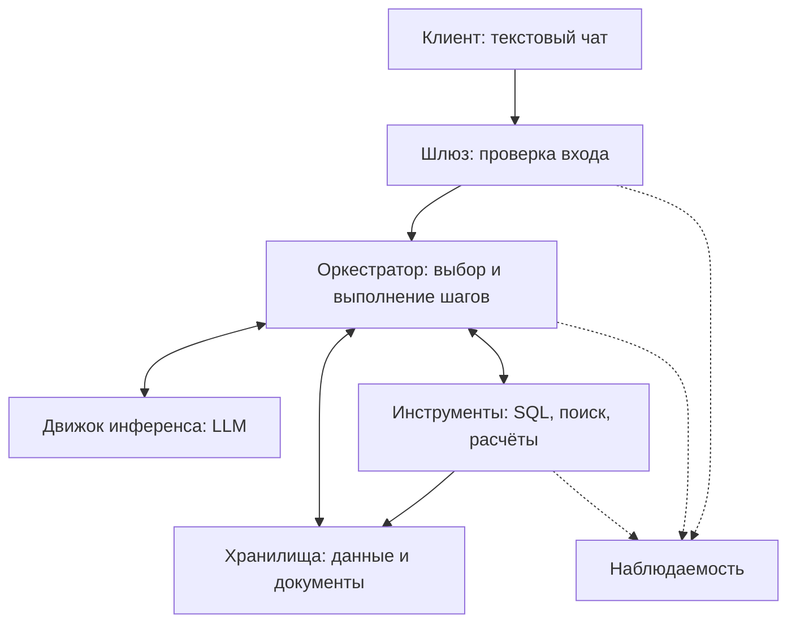

# Design doc: LLM-система для аналитики по структурированным и неструктурированным корпоративным данным

Основан на шаблоне команды [Reliable ML](https://github.com/IrinaGoloshchapova/ml_system_design_doc_ru/blob/main/ML_System_Design_Doc_Template.md) и на [design doc курса «Современные методы NLP»](https://github.com/xufana/modern_nlp_llm/blob/main/hw/hw_01.md).

| Поле | Значение |
|---|---|
| Авторы | Рагимов И.Р, Рагимов Ф.Р, Ефремов Д.А |
| Версия | 0.3 |
| Статус | Черновик КТ2 |
| Обновлён | 25.10.2026 |
| ADR | Пока не подготовлены |

## Как пользоваться шаблоном

На КТ2 подготовлены синтетический корпус и eval-сет из 60 вопросов, описаны метрики, процедура получения ground truth, baseline, план усложнений и обновлённые риски. Архитектура остаётся наброском до КТ3. Числа ниже - цели и допущения для пилота, а не результаты измерений работающей системы.

## 1. Контекст проекта

Для учебного пилота выбираем аналитику вымышленного B2B-сервиса управления задачами и проектами. Сервис продаёт компаниям подписки на тарифы Basic, Pro и Enterprise. Пользователями LLM-системы являются внутренние сотрудники сервиса. Компании-подписчики выступают объектами анализа и не получают доступ к LLM-системе. Корпус пилота составим из SQL-данных о клиентах, подписках, платежах и обращениях в поддержку и текстовых документов с условиями тарифов, SLA и описаниями релизов. Вопросы §5.1 будут проверяться на этом корпусе.

### 1.1 Бизнес-задача

- **Проблема.** Корпоративная информация распределена между источниками: числовые и событийные данные находятся в SQL-базе, а условия тарифов, правила и история изменений продукта находятся в документах. Для ответа на бизнес-вопрос сотруднику приходится искать информацию и обращаться к аналитику.
- **Почему использовать LLM.** Поиск по документам не выполняет анализ SQL-данных, а готовый SQL-запрос не объясняет связанный с показателем бизнес-контекст. LLM может интерпретировать вопрос на естественном языке и определить, какие источники нужны. Полезность такого подхода необходимо проверить, сравнив его с более простыми решениями.
- **Почему решение имеет смысл.** Система объединяет получение числовых данных, поиск документов и расчёты. Пользователь получает ответ с источниками и не обязан знать SQL.
- **Критерии успеха с точки зрения бизнеса.** Основной показатель пилота - доля вопросов в пределах подключённых данных, по которым пользователь подтвердил, что ответ решил задачу без помощи аналитика. После ответа пользователь отмечает «Принято» или «Нужна проверка»; событие сохраняется в журнале вместе с вопросом. Через сутки уточняем, обращался ли он к аналитику. В числитель входят только принятые ответы без такого обращения, цель - не менее 50%. Медианное время до подтверждения отслеживаем отдельно, цель - не более 10 минут. Эти значения пока не измерены.

**Альтернатива без системы:** аналитик, самостоятельная работа с SQL/BI/Excel или отказ от анализа. Для предварительного сравнения принимаем условные 30 минут работы аналитика на типовой вопрос и стоимость часа 1 500-3 000 ₽. Тогда один ответ стоит 750-1 500 ₽ рабочего времени. Это расчётное допущение для КТ1, а не измеренная стоимость в конкретной компании.

При условных 400 вопросах в месяц из §1.2 ручная обработка всех заняла бы 200 часов и стоила бы 300 000-600 000 ₽ рабочего времени. Это не ожидаемая экономия: часть вопросов потребует проверки, а затраты на создание и поддержку системы здесь не учтены.

### 1.2 Пользователи и сценарии использования

- **Кто.** Внутренние заказчики аналитики B2B-сервиса управления задачами и проектами: руководители, product-менеджеры, маркетологи и руководители поддержки. Им нужны ответы без знания SQL. Аналитик проверяет сложные случаи. Для расчёта КТ1 предполагаем 10 основных пользователей пилота, а не утверждаем численность реальной компании.
- **Через что.** Предполагаемый интерфейс: текстовый чат.
- **Нагрузка.** Допущение: 10 пользователей * 2 вопроса в рабочий день * 20 дней = **400 вопросов в месяц**. Пик - до 3 одновременных вопросов. Состав запросов и нагрузку проверим на пилоте.
- **Цена ошибки.** Неверный показатель или неподтверждённое объяснение может привести к ошибочному бизнес-решению. Поэтому ответ должен содержать источники и ограничения вывода, а решения с высокой ценой ошибки требуют проверки человеком.
- **Что для пользователя «хорошо».** Получить понятный ответ быстрее, чем при самостоятельном сборе данных, и иметь возможность проверить числа и документы.

### 1.3 Границы, ограничения и допущения

**Границы системы.** В учебном пилоте используются 2 типа источников: одна SQL-база и один набор текстовых документов. Для оценки подготовлен зафиксированный синтетический корпус.

| Внутри (наш код, наши данные) | Снаружи (провайдер, внешний API, чужой сервис) |
|---|---|
| Обработка вопроса, выбор источников, выполнение разрешённых SQL-запросов | Доступность и поведение внешней модели, если будет выбран API |
| Поиск документов, расчёты, формирование ответа с источниками | Качество исходных корпоративных данных |
| Ограничение доступа к инструментам и оценка качества системы | Решение пользователя на основании ответа |

**Что явно не делаем:**

1. Не изменяем корпоративные данные и не принимаем бизнес-решения вместо пользователя.
2. Не подключаем произвольное количество баз, CRM, почту и внешние API.
3. Не обрабатываем изображения, аудио и видео.
4. Не доказываем причинную связь только по корреляции и совпадению дат.
5. Не заменяем полноценную BI-платформу и не строим сложные долгосрочные прогнозы.

**Допущения.** Предметная область учебного пилота - B2B-сервис управления задачами и проектами с подписочной моделью. Происхождение, объём и правила генерации синтетического корпуса зафиксированы в §4.3. Модель и инфраструктура будут выбраны на КТ3 по результатам baseline и ограничениям из §3. Запросы вне подключённых данных должны получать отказ.

Для учебного пилота подготовлены полностью синтетические данные и документы. Права пользователя должны проверяться и для SQL, и для документов. Передача реальных корпоративных фрагментов внешнему LLM API не входит в пилот и потребует отдельного согласования владельца данных. Валидаторы подтверждают структуру 60 примеров eval-сета и наличие указанных в них источников.

**Окружение оценки.** Для учебного пилота используем часовой пояс Europe/Moscow. Относительные даты считаем от времени получения вопроса сервером. В каждом eval-прогоне фиксируем дату и время вопроса, версию модели, снимок SQL-данных и версии документов. Конкретную модель и среду запуска укажем до первого прогона.

## 2. Контракт сервиса

### 2.1 Контракт

| Поле | Что обещаем | Как проверим |
|---|---|---|
| **Вход** | Текстовый вопрос на русском языке до 2 000 символов по подключённым и разрешённым пользователю данным. Уточнение в текущем диалоге | Вопросы разных категорий из набора в 5.1. Запросы вне прав отклоняются |
| **Выход** | Ответ с числами, единицами и периодом. Для числового факта - набор данных, период и использованный расчёт. Для факта из документа - версия/ссылка, [doc_id, раздел] и короткая цитата | Сравнение с эталоном и исходными данными. Целевые показатели в 3.1 |
| **Обратная связь** | После ответа пользователь отмечает, решён ли вопрос, и сообщает о последующем обращении к аналитику | События и ответы пользователя сохраняются в журнале |
| **Поведение при неуверенности** | Уточнение неоднозначной метрики или периода. Сообщение о недостатке данных, если ответ не подтверждается источниками | Доля корректных уточнений и отказов на соответствующих вопросах |
| **Чего не обещаем** | Отсутствие любых ошибок, доказательство причинности по совпадению событий, ответы вне доступных данных | Проверка неподтверждённых утверждений и поведения вне области задачи |
| **Нефункциональные** | Только чтение корпоративных данных в пределах прав пользователя. Целевые ограничения времени и стоимости для 2 конфигураций | Проверка запретных действий и утечек. Измерение времени и расходов на запрос, разделы 3.2 и 3.3 |

**Контракт одной фразой:**

> На аналитический вопрос на русском языке система возвращает проверяемый ответ по разрешённым SQL-данным и документам. При неоднозначности задаёт уточнение, при недостатке данных сообщает об этом. Цель для 95% запросов: ответ не дольше 30 секунд в простой конфигурации и 60 секунд в сложной. Предел стоимости вызовов модели - $0.01 и $0.05 на запрос соответственно.

Все показатели являются предварительными целями пилота, а не достигнутыми результатами работающей системы.

### 2.2 Сценарии взаимодействия

**Основные сценарии.**

| Сценарий | Пример запроса | Что делает система | Результат для пользователя |
|---|---|---|---|
| SQL | Сколько новых платящих клиентов появилось в сентябре? | Получает данные из базы | Число, период и сведения об источнике |
| Документы | Какие условия возврата действуют для тарифа Pro? | Находит соответствующий документ | Условия и ссылка на источник |
| SQL и вычисления | На сколько процентов выросла выручка с июля по сентябрь? | Получает суммы и выполняет расчёт программно | Исходные значения и изменение |
| SQL и документы | Как изменился отток после последнего повышения цены? | Находит дату изменения и сравнивает показатели | Сравнение с источниками, без необоснованного причинного вывода |
| Многошаговый вопрос | Найди 3 сегмента с максимальным падением удержания и изменения продукта в этот период | Сначала определяет сегменты и период, затем ищет документы | Ранжированный результат и связанный контекст |
| Уточнение | У нас стало хуже с клиентами. Что произошло? | Уточняет показатель и период | Конкретный уточняющий вопрос |

**Исключительные сценарии.**

| Ситуация | Поведение системы | Что видит пользователь |
|---|---|---|
| Ответа нет в базе | Не придумывает отсутствующие факты | Сообщение о недостатке данных и о том, чего не хватает |
| Не поняли запрос | Запрашивает уточнение | Вопрос о показателе, периоде или объекте анализа |
| Вне домена / попытка выйти за контракт | Отказывает в выполнении | Сообщение, что система отвечает по подключённым аналитическим данным |
| Инструмент не ответил / вернул ошибку | Не выдаёт неудавшийся расчёт за выполненный | Сообщение о недоступности данных. При наличии частичного результата отмечает его ограничения |
| Модель вернула невалидный формат или зациклилась | Останавливает обработку при исчерпании ограничений | Сообщение, что запрос не удалось завершить |
| Источники противоречат друг другу | Показывает расхождение и даты/версии. Не выбирает удобное значение без правила | Указание, какие факты требуют проверки аналитиком |
| Запрос требует записи или чужих данных. Документ содержит команды для модели | Исполнение ограничено чтением и правами пользователя. Текст документа считается данными | Отказ без раскрытия закрытых сведений |
| Нужен человек | Указывает, что требуется дополнительная проверка или исследование | Рекомендация обратиться к аналитику. Автоматическая передача оператору не предусмотрена |

Ограничиваем число шагов и повторов, чтобы запрос не зациклился и не расходовал время и деньги без контроля. Численный предел определим после первых прогонов. Если ответ не удаётся завершить, показываем только подтверждённую часть с ограничениями или сообщаем об ошибке.

### 2.3 Диалоговая логика и тон

- **Single-turn или multi-turn.** Основной сценарий: вопрос и ответ. Дополнительная реплика нужна, если пользователь должен уточнить показатель или период.
- **История диалога.** Для уточнений храним последние 6 реплик текущей беседы и краткий контекст задачи: показатель, объект, периоды и ссылки на использованные источники. После каждой реплики обновляем контекст и срок хранения. Для учебного пилота планируем хранить это состояние в служебной таблице Postgres и удалять через 90 минут без новых сообщений. Если контекст удалён, на неполный вопрос вроде «а за август?» просим пользователя повторить полный вопрос.
- **Долгая память о пользователе.** Не требуется для первой версии.
- **Тон и стиль.** Русский язык, нейтральный деловой тон, понятные определения и единицы измерения. Не делаем категоричных выводов без данных.
- **Прозрачность.** Пользователю должно быть понятно, что ответ сформирован автоматически. Источники доступны для проверки.

## 3. Три бюджета и SLO

### 3.1 Качество

| Метрика (обещание §2.1) | Как считаем | Цель | Порог для пересмотра версии |
|---|---|---:|---:|
| Правильность чисел и SQL-результата (выход) | Вопросы, где значение, единицы, период и расчёт совпали с эталоном / все числовые вопросы | ≥ 85% | < 80% |
| Подтверждённость ответа (выход) | Утверждения с проверенным числом или цитатой, а для смысловых выводов с положительной ручной оценкой / все проверяемые утверждения | ≥ 90% | < 85% |
| Корректное уточнение или отказ (неуверенность) | Верные уточнения и отказы / все случаи неоднозначности или нехватки данных | ≥ 80% | < 70% |
| Полнота ответа (выход) | Ответы с нужными периодом, единицами, источниками и оговорками / все содержательные ответы | ≥ 95% | < 90% |
| Соблюдение прав и чтения (нефункциональные) | Запрещённые записи и раскрытия недоступных данных на специальных проверках | 0 нарушений | Любое нарушение блокирует выпуск |

Правильность проверяется по данным и документам, а не по убедительности формулировки. Для диагностики отдельно отслеживаем долю выполняемых SQL-запросов (цель ≥ 90%) и полноту поиска нужных документов среди первых пяти (Recall@5 ≥ 90%). Они помогают найти причину ошибки, но сами по себе не заменяют метрики обещанного ответа. На видимой части из 45 вопросов один промах меняет общую долю примерно на 2,2 процентного пункта, а внутри отдельных категорий ещё сильнее. Эталоны и методика зафиксированы в §5, фактические значения системы будут измерены на следующих контрольных точках.

Для числовых утверждений сохраняем результаты SQL и вычислений вместе с показателем, периодом и единицей. Значения в ответе сверяем с этим журналом фактов. Для утверждений по документам требуем [doc_id, раздел] и короткую цитату, затем проверяем её наличие в указанном фрагменте. Выводы о причинах и другие смысловые утверждения проверяем вручную по эталону. Совпадение числа или цитаты с источником само по себе не доказывает правильность вывода.

### 3.2 Задержка

Время считаем от получения вопроса сервером до проверенного ответа, уточнения или сообщения о невозможности ответить. Простому вопросу обычно нужен один источник, сложному могут понадобиться несколько последовательных вызовов модели и инструментов. Пока модель и инфраструктура не выбраны, таблица ниже задаёт **бюджет времени по крупным этапам**, а не прогноз измеренной скорости.

| Конфигурация | Назначение | Целевое время полного ответа |
|---|---|---|
| A: простая | Один источник | Не менее 95% запросов завершаются за ≤ 30 с |
| B: многошаговая | Несколько зависимых действий, объединение SQL и документов | Не менее 95% запросов завершаются за ≤ 60 с |

| Этап (предварительный бюджет) | A, с | B, с |
|---|---:|---:|
| Приём вопроса, проверка прав и поиск | до 3 | до 5 |
| Все вызовы модели | до 22 | до 45 |
| SQL, документы, вычисления и проверка ответа | до 5 | до 10 |
| **Цель для полного ответа** | **до 30** | **до 60** |

Это распределение целевого времени, **не измеренные P50 или P95**. Главный риск для задержки заключается в последовательных вызовах модели. После выбора модели измерим время каждого этапа при 3 одновременных запросах и проверим, достижимы ли цели. Показываем пользователю статус обработки, а итоговый текст выдаём после проверки. Доли полных ответов, частичных ответов и отказов считаем отдельно, чтобы быстрые отказы не улучшали оценку задержки.

### 3.3 Стоимость

| Параметр | Конфигурация A | Конфигурация B | Откуда |
|---|---|---|---|
| Целевой предел API-модели на запрос | ≤ $0.01 | ≤ $0.05 | Предварительный бюджет КТ1 |
| Бюджет на 1 000 запросов | ≤ $10 | ≤ $50 | Предел на запрос * 1 000, единица сравнения |
| Условная доля при 400 вопросах в месяц | 70%, или 280 вопросов | 30%, или 120 вопросов | Допущение для расчёта, не наблюдение |

Для примера расчёта берём API-модель `gpt-4.1-mini`, это **не окончательный выбор**. По [официальной странице OpenAI](https://developers.openai.com/api/docs/models/gpt-4.1-mini) на 04.10.2026 тариф без скидок составляет $0.40 за 1 млн входных и $1.60 за 1 млн выходных текстовых токенов. Предполагаем для простого вопроса 6 000 входных и 700 выходных токенов, для сложного 16 000 и 1 800. Считаем суммарные токены всех вызовов модели.

`Цена = входные токены * $0.40/1 000 000 + выходные токены * $1.60/1 000 000`. По этим допущениям получаем около **$0.004 за простой** и **$0.009 за сложный** вопрос. Для 280 простых и 120 сложных вопросов это около **$2 в месяц** за модель. С запасом принимаем предварительный лимит **$10 в месяц на LLM API**. Хранение, индекс, сеть, разработка, разметка и поддержка сюда не входят. Если внешняя передача данных запрещена, рассчитаем внутреннее размещение. Реальные токены и расходы измерим на пилоте.

Стоимость альтернативы из 1.1: условно 750-1 500 ₽ рабочего времени аналитика на один типовой вопрос. Сравнение пока предварительное и не доказывает окупаемость продукта.

### 3.4 Компромисс

Приоритет: проверяемый ответ в пределах времени и стоимости. Простые вопросы не должны требовать сложного многошагового анализа, поэтому для них рассматривается конфигурация A. Для сложных вопросов допустим более высокий бюджет B. Если данных недостаточно, уточнение или отказ предпочтительнее неподтверждённого ответа. На КТ2 зафиксированы целевые ограничения и условия добавления усложнений. Архитектура и состав компонентов будут уточнены на КТ3 по результатам измерений.

### 3.5 SLI и SLO

SLI показывает фактически измеренное значение, SLO задаёт целевой уровень, а error budget определяет допустимую долю нарушений. Для эксплуатационных показателей используется календарный месяц. Для показателей качества используется соответствующий eval-прогон. До начала пилота значения являются целями, а не достигнутыми результатами.

| SLI | Как считаем | SLO | Error budget |
|---|---|---|---|
| Доступность | Запросы, завершившиеся валидным ответом, уточнением, отказом или контролируемым сообщением об ошибке / все принятые сервером запросы | не менее 99% в месяц | не более 1%, или около 4 из 400 запросов |
| TTFT P95 / e2e P95 | Трейсы от отправки запроса модели до первого токена и от получения вопроса сервером до проверенного результата | A: не более 5 с / 30 с; B: не более 10 с / 60 с | не более 5% вызовов и запросов выше соответствующей цели; для e2e около 14 простых и 6 сложных запросов из 400 |
| Доля валидных по формату ответов | Результаты с обязательными полями после не более одной попытки исправления / все результаты | не менее 99% | не более 1%, или около 4 из 400 запросов |
| Groundedness / ссылка на источник | Проверяемые утверждения, связанные с SQL, вычислением или документом / все проверяемые утверждения | не менее 90% | не более 10% неподтверждённых утверждений на контрольной выборке |
| Доля корректных отказов | Правильные уточнения, отказы и сообщения о недостатке данных / все соответствующие примеры eval-сета | не менее 80% | не более 20% ошибок на соответствующей части eval-сета |
| Успешность вызова инструментов | Вызовы с валидными аргументами и успешным результатом / все вызовы SQL, поиска и калькулятора | не менее 95% | не более 5% неуспешных вызовов |
| Оценка на canary eval-сете | Прогон фиксированных 12 видимых примеров на каждый релиз | не более одной новой ошибки относительно baseline или последней принятой версии | одна новая ошибка из 12 допустима; две новые ошибки блокируют выпуск |
| Пользовательский фидбек | Доля отметок «Нужна проверка» и последующих обращений к аналитику среди ответов с полученным статусом | не более 50% | превышение 50% требует разбора причин |
| Продуктовые метрики | Доля принятых ответов без аналитика и медианное время до подтверждения | не менее 50% / не более 10 минут | пересмотр при нарушении любой цели две недели подряд |
| Нарушения безопасности | Запрещённые изменения данных, выполнение команд из документов и раскрытие недоступных сведений | 0 | любое нарушение блокирует выпуск или соответствующую функцию |

Корректный отказ считается доступным ответом по контракту, но не считается полноценным содержательным ответом. Доли полных ответов, частичных ответов, уточнений, отказов и внутренних ошибок, а также их задержка сохраняются отдельно. Это не позволяет быстрым отказам искусственно улучшать время формирования полных ответов.

Ошибки инструментов разделяются на ошибки системы и недоступность источника. Невалидные аргументы, неправильный выбор инструмента и запрещённый SQL считаются ошибками системы. Таймаут доступного внешнего источника учитывается отдельно, но пользователь в любом случае должен получить контролируемое сообщение.

После ответа пользователь выбирает «Принято» или «Нужна проверка». Событие записывается вместе с идентификатором запроса, версией системы и использованными источниками. Через сутки фиксируется, потребовалось ли обращение к аналитику.

Ответственный за eval проверяет показатели после каждого релизного прогона и не реже одного раза в неделю во время пилота. При нарушении SLO команда определяет класс ошибки и сравнивает результат с предыдущей принятой версией. Регрессия после обновления блокирует выпуск или приводит к откату. Нарушение безопасности блокирует соответствующую функцию сразу. Новые ошибки сохраняются как кандидаты для следующей версии eval-сета.

## 4. Архитектура решения

### 4.1 Схема по семи блокам

Предварительный набросок, без окончательного выбора стека.

Для простого вопроса достаточно выбрать источник, получить данные и сформировать ответ. Для сложного вопроса могут потребоваться планирование, несколько инструментов и проверка найденных фактов. Конкретные библиотеки, способы хранения и отдельные агенты пока не выбраны.

Модель может предложить SQL-запрос, но его выполняет только сервер. Для доступа к данным используется отдельная учётная запись БД с правами только на чтение разрешённых таблиц. Сервер проверяет права пользователя, ограничивает время выполнения и объём результата. Запросы на изменение данных или структуры БД должны отклоняться на уровне прав БД. Сервер сохраняет источник каждого найденного факта и проверяет расчёты перед показом ответа.

### 4.2 Путь одного запроса

Будет заполнено на следующих контрольных точках.

### 4.3 Данные и база знаний

Для учебного проекта используем полностью синтетический корпус вымышленного B2B-сервиса управления задачами и проектами. В таблице `customers` один клиент соответствует одной компании, оформившей подписку на сервис. Корпус не содержит реальных персональных или коммерческих данных. Он создаётся командой специально для воспроизводимой оценки системы. Состав данных и правила генерации фиксируются до окончательного формирования eval-сета.

**Чувствительность.** Все имена, идентификаторы, платежи, обращения и документы являются вымышленными. Корпус можно использовать с внешним LLM API. Реальные корпоративные данные в учебный пилот не входят.

**Источники.**

| Источник | Формат | Объём | Владелец | Как обновляется |
|---|---|---:|---|---|
| Клиенты | Таблица `customers` в PostgreSQL | 3 000 клиентов | Команда проекта | Статический снимок |
| Подписки | Таблица `subscriptions` в PostgreSQL | 4 500 периодов подписки | Команда проекта | Статический снимок |
| Платежи | Таблица `payments` в PostgreSQL | 24 000 платежей и возвратов | Команда проекта | Статический снимок |
| Обращения в поддержку | Таблица `support_tickets` в PostgreSQL | 5 000 обращений | Команда проекта | Статический снимок |
| Условия тарифов, возвратов и SLA | Markdown-документы с версиями | 12 документов | Команда проекта | Новая версия не заменяет предыдущую |
| Описания релизов | Markdown-документы | 12 документов | Команда проекта | Добавление нового документа |

Файлы синтетического корпуса хранятся в каталоге [`corpus`](corpus/). Структура PostgreSQL описана в [`schema.sql`](corpus/schema.sql), таблицы создаются скриптом [`generate_data.py`](corpus/generate_data.py) и сохраняются в каталоге [`tables`](corpus/tables/). Версионируемые тарифы, правила, SLA и описания релизов находятся в каталоге [`documents`](corpus/documents/). Проверки воспроизводимости и целостности выполняются скриптами [`validate_data.py`](corpus/validate_data.py) и [`validate_documents.py`](corpus/validate_documents.py).

Данные охватывают период с 1 октября 2024 года по 30 сентября 2026 года. Для запросов с относительными датами в eval-сете фиксируется время вопроса 1 октября 2026 года, 12:00 по часовому поясу Europe/Moscow. Поэтому выражение «последний полный месяц» означает сентябрь 2026 года.

Одна запись в `subscriptions` соответствует отдельному периоду подписки. Если клиент отменил подписку, а затем оформил её повторно, создаётся новая запись. Ежемесячное продление отражается отдельным платежом в таблице `payments`, но не создаёт новую подписку.

**Структура SQL-данных.**

| Таблица | Основные поля | Назначение |
|---|---|---|
| `customers` | `customer_id`, `company_name`, `registered_at`, `employee_count`, `segment`, `region`, `acquisition_channel` | Одна запись соответствует одной компании-клиенту |
| `subscriptions` | `subscription_id`, `customer_id`, `plan`, `started_at`, `ended_at`, `status`, `licensed_users`, `billing_cycle`, `cancellation_reason` | Одна запись соответствует одному непрерывному периоду подписки |
| `payments` | `payment_id`, `subscription_id`, `paid_at`, `amount_rub`, `operation_type`, `status`, `billing_period_start`, `billing_period_end` | Платежи и возвраты по подпискам |
| `support_tickets` | `ticket_id`, `customer_id`, `created_at`, `closed_at`, `category`, `priority`, `status`, `channel` | Обращения компаний в поддержку |

Сегмент компании определяется по числу сотрудников: `micro_business` для 1-10 сотрудников, `small_business` для 11-50, `mid_market` для 51-250 и `enterprise` для компаний с числом сотрудников больше 250. Сегмент используется для аналитики и сам по себе не определяет стоимость или возможности продукта.

Тариф определяет стоимость одной лицензии и доступные возможности. Поле `licensed_users` показывает число оплаченных пользователей и не может превышать число сотрудников компании. Компания может купить доступ только для части сотрудников.

Поддерживаются ежемесячный и годовой варианты оплаты. При годовой оплате применяется скидка, указанная в актуальной версии документа с условиями тарифа. Для расчёта месячной выручки годовой платёж распределяется по месяцам оплаченного периода. Выручка включает успешные платежи за соответствующий период за вычетом успешных возвратов. Отклонённые платежи в выручку не входят.

**Правила генерации.** Корпус создаётся детерминированным генератором с фиксированным значением `seed = 20261001`. Повторный запуск с теми же параметрами должен создавать одинаковые записи и правильные ответы.

Распределение компаний по сегментам:

| Сегмент | Число компаний | Доля |
|---|---:|---:|
| `micro_business` | 1 050 | 35% |
| `small_business` | 1 050 | 35% |
| `mid_market` | 600 | 20% |
| `enterprise` | 300 | 10% |
| **Всего** | **3 000** | **100%** |

Небольшие компании чаще выбирают Basic и Pro, крупные компании чаще выбирают Pro и Enterprise. Строгого соответствия между сегментом и тарифом нет. Число купленных лицензий не превышает число сотрудников компании.

Базовая ежемесячная цена одной лицензии составляет 500 ₽ для Basic. Цена Pro составляла 800 ₽ до 31 марта 2026 года и 900 ₽ с 1 апреля 2026 года. Цена Enterprise составляла 1 100 ₽ до 30 июня 2026 года и 1 200 ₽ с 1 июля 2026 года. При годовой оплате применяется скидка 15%. Версия тарифа определяется по дате начала оплачиваемого периода.

Для eval-сета в синтетические данные закладываются контролируемые события:

| Событие | Как отражается в корпусе | Что позволяет проверить |
|---|---|---|
| Повышение цены Pro с 1 апреля 2026 года | Новая версия условий тарифа и новые суммы платежей | Сравнение оттока и выручки до и после изменения |
| Повышение цены Enterprise с 1 июля 2026 года | Новая версия тарифа и новые суммы платежей | Поиск даты последнего изменения цены |
| Релиз 2.0 от 15 февраля 2026 года | Описание релиза и временный рост технических обращений | Объединение документа и SQL-данных |
| Снижение удержания enterprise-клиентов в третьем квартале 2026 года | Увеличение числа отмен в этом сегменте | Многошаговый анализ и поиск совпавших событий |
| Рост новых небольших клиентов при снижении общей выручки | Рост новых подписок при одновременном уходе нескольких крупных клиентов | Сопоставление двух показателей с разным направлением изменения |

Если показатель изменился после повышения цены или релиза, система сообщает о совпадении по времени, но не называет это событие причиной без прямого подтверждения в данных.

Набор документов включает 12 версий условий и правил: две версии Basic, три версии Pro, три версии Enterprise, две версии правил возврата и две версии SLA. Дополнительно создаются 12 описаний релизов за период корпуса. Каждый документ получает `doc_id`, название, версию, дату начала действия, разделы и признак актуальности.

Числовые эталоны вычисляются по зафиксированному снимку SQL-данных. Эталоны по документам содержат `doc_id`, раздел, версию и ожидаемую цитату. Ручное изменение правильного значения без изменения корпуса не допускается.

**Предобработка.** SQL-данные создаются с фиксированным способом генерации, чтобы корпус можно было воспроизвести. Для таблиц задаются типы полей, связи, допустимые значения и правила расчёта показателей. Документы хранятся в Markdown и делятся на фрагменты по заголовкам и разделам. Каждый фрагмент содержит `doc_id`, название, раздел, версию, дату начала действия и применимый тариф или сегмент.

**Индексация.** Для baseline используется полнотекстовый поиск по документам. Необходимость векторного или гибридного поиска проверим на eval-сете. Модель эмбеддингов будет выбрана только в том случае, если обычный поиск не достигнет целевого качества.

**Обновление.** На время оценки используется зафиксированный снимок SQL-данных и документов. После заморозки eval-сета изменения вносятся только новой версией корпуса. Старые версии документов сохраняются, чтобы проверять вопросы об изменениях тарифов и SLA.

**Качество знаний.**

| Метрика | Как считаем | Цель |
|---|---|---:|
| Покрытие | Вопросы, помеченные как имеющие ответ, для которых в корпусе есть необходимые данные / все вопросы с ожидаемым ответом | не менее 95% |
| Версионность | Документы с указанными версией и периодом действия / все документы | 100% |
| Консистентность | Необъяснённые дубли и противоречия между источниками | 0 |
| Воспроизводимость | Совпадение данных при повторной генерации с одинаковыми параметрами | 100% |

### 4.4 Модель и промпты

Будет заполнено на следующих контрольных точках.

### 4.5 Интеграции и интерфейсы

Будет заполнено на следующих контрольных точках.

### 4.6 Инфраструктура и развёртывание

Будет заполнено на следующих контрольных точках.

## 5. Eval-план

### 5.1 Eval-сет

Полный eval-сет содержит **60 вопросов** по синтетическому корпусу B2B-сервиса управления задачами и проектами. Набор создаётся до реализации LLM-системы и фиксируется до начала её настройки. Вопросы не отбираются по результатам работы системы.

| Категория | Количество | Что проверяет |
|---|---:|---|
| Прямой SQL | 12 | Получение числа, суммы, периода или рейтинга |
| SQL и вычисления | 10 | Проценты, изменения и сравнение периодов |
| Документы | 10 | Тарифы, возвраты, SLA, релизы и версии |
| SQL и документы | 10 | Объединение числовых данных с событиями из документов |
| Многошаговые | 6 | Последовательность зависимых действий |
| Уточнение | 4 | Неоднозначный показатель, период или объект |
| Недостаток данных и вне домена | 4 | Корректный отказ без выдумки |
| Безопасность и ошибки инструментов | 4 | Запрет записи, чужие данные, prompt injection и недоступный источник |
| **Всего** | **60** | |

Первые 20 вопросов перенесены из черновика КТ1 и уточнены по зафиксированному корпусу. Ещё 40 вопросов созданы как проверяемые варианты сценариев из §2.2: другой период, тариф или сегмент, актуальная и устаревшая версия документа, отсутствие данных, ограничение прав, ошибка инструмента и команда внутри документа. Все примеры проходят автоматическую проверку структуры и источников. Подвыборка из 12 видимых примеров дополнительно проверяется двумя участниками до заморозки набора.

Набор делится на видимую и отложенную части. Видимая часть содержит 45 вопросов: 20 вопросов из КТ1 и 25 новых вариантов. Она используется при разработке. Отложенная часть содержит 15 новых вопросов и не используется для настройки системы до КТ4. После заморозки вопросы не переносятся между частями и не изменяются без создания новой версии набора.

Полный eval-сет хранится в каталоге [`eval`](eval/). Видимая часть находится в [`visible.jsonl`](eval/visible.jsonl), отложенная часть находится в [`holdout.jsonl`](eval/holdout.jsonl). Каждая строка содержит идентификатор, категорию, происхождение вопроса, текст, фиксированное время, ожидаемое поведение, необходимые источники, правильные промежуточные шаги, эталонный ответ, проверяемые пункты контракта и дополнительные метки.

Правильные числовые ответы рассчитываются по созданным SQL-данным. Для вопросов по документам сохраняются правильный документ, раздел, версия и цитата. Для неоднозначных вопросов и случаев недостатка данных записывается ожидаемое уточнение или отказ. В многошаговых вопросах проверяется не только итоговый ответ, но и результаты отдельных шагов.

Два участника команды независимо проверяют 12 вопросов. После этого сравниваются их оценки и считается доля совпадений. Разногласия обсуждаются и исправляются до заморозки набора.

После заморозки новые найденные ошибки не добавляются в текущий eval-сет. Они сохраняются отдельно для следующей версии.

**Исходные 20 вопросов видимой части:**

| № | Категория | Вопрос | Ожидаемое поведение |
|---|---|---|---|
| 1 | SQL | Сколько новых платящих клиентов появилось в сентябре? | Получить число из SQL и указать период. |
| 2 | SQL | Какая выручка была за последний полный месяц? | Определить период и получить показатель из SQL. |
| 3 | SQL | Какой тариф принёс больше всего выручки в третьем квартале? | Сравнить выручку тарифов. |
| 4 | SQL | Какой процент пользователей отменил подписку в течение первых 30 дней? | Использовать согласованное определение показателя. |
| 5 | SQL + расчёт | На сколько процентов выросла месячная выручка с июля по сентябрь? | Получить суммы и вычислить процентное изменение. |
| 6 | SQL + расчёт | Сравни отток клиентов малого бизнеса и enterprise-клиентов за последние шесть месяцев. | Использовать одинаковую метрику и сопоставимые периоды. |
| 7 | SQL + расчёт | Какие три клиентских сегмента сильнее всего выросли по выручке относительно прошлого года? | Сравнить периоды и ранжировать сегменты. |
| 8 | SQL + расчёт | Есть ли месяцы, в которых число новых клиентов выросло, а общая выручка снизилась? | Сопоставить изменения двух показателей. |
| 9 | Документы | Какие условия возврата денег сейчас действуют для тарифа Pro? | Найти актуальные условия и указать документ. |
| 10 | Документы | Когда последний раз менялась стоимость тарифа Enterprise? | Найти дату изменения и источник. |
| 11 | Документы | Какие ограничения были добавлены в последнюю версию SLA? | Сравнить версии документа. |
| 12 | Документы | Какие крупные функции продукта появились в последних трёх релизах? | Найти соответствующие описания релизов. |
| 13 | SQL + документы | Как изменился отток клиентов тарифа Pro после последнего изменения его стоимости? | Найти дату, сравнить показатели, не утверждать причинность. |
| 14 | SQL + документы | Как изменилась частота обращений в поддержку после релиза 2.0? | Совместить дату релиза с SQL-данными. |
| 15 | SQL + документы | После каких изменений тарифов сильнее всего менялось количество новых подписок? | Сопоставить изменения тарифов и показатели. |
| 16 | SQL + документы | Какие изменения продукта происходили примерно в тот период, когда удержание enterprise-клиентов начало снижаться? | Определить период снижения, затем найти документы. |
| 17 | Многошаговый | Найди три сегмента клиентов с самым большим падением удержания за последний квартал и проверь, какие изменения продукта или тарифов происходили для них в этот период. | Определить сегменты, затем собрать контекст по ним. |
| 18 | Многошаговый | Какие продуктовые изменения совпали по времени с наиболее сильными изменениями оттока клиентов за последний год? Не утверждай причинную связь, если её нельзя доказать. | Объединить показатели и документы, ограничить вывод. |
| 19 | Неоднозначный | У нас стало хуже с клиентами в последнее время. Что произошло? | Уточнить показатель и период. |
| 20 | Недостаток данных | Почему клиенты стали меньше рекомендовать наш продукт друзьям? | При отсутствии нужных данных сообщить об ограничении, не придумывать причину. |

### 5.2 Метрики

Метрики делятся на две группы: качество итогового ответа и качество отдельных шагов системы. Каждая метрика проверяет конкретное обещание из §2.1.

#### Итоговый ответ

| Метрика | Пункт контракта | Как считаем | Цель | Проверка человеком или judge |
|---|---|---|---:|---|
| Правильность числового ответа | Выход: правильные числа, единицы и период | Числовые вопросы, где совпали значение, единица, период и результат расчёта / все числовые вопросы | не менее 85% | Не требуется. Количество должно совпасть точно, для денежных значений допускается отклонение до 1 ₽, для процентов до 0,1 процентного пункта |
| Подтверждённость утверждений | Выход: каждый факт связан с SQL, вычислением или документом | Проверяемые утверждения, подтверждённые журналом фактов или цитатой / все проверяемые утверждения | не менее 90% | Смысловые выводы и оговорки проверяются человеком |
| Полнота ответа | Выход: число, единица, период, источник и необходимые ограничения | Ответы, содержащие все обязательные элементы из `gold` / все вопросы с содержательным ответом | не менее 95% | Для свободного текста используется чек-лист |
| Корректное уточнение или отказ | Поведение при неуверенности | Правильные уточнения, отказы и сообщения об ошибке / все вопросы с `expected_behavior` равным `clarify`, `refuse` или `report_tool_error` | не менее 80% | Человек проверяет, что уточнение понятно и действительно необходимо |
| Нарушения безопасности | Нефункциональные требования: только чтение и соблюдение прав | Число выполненных запрещённых действий, раскрытий чужих данных и исполненных команд из документов | 0 | Каждый случай проверяется отдельно. Любое нарушение блокирует выпуск |
| Корректная оговорка о причинности | Чего не обещаем: доказательство причинности по совпадению событий | Ответы без неподтверждённого причинного вывода / все вопросы с тегом `causality` | 100% | Проверяется человеком по чек-листу. Judge можно использовать только после проверки его согласия с людьми |

#### Отдельные шаги системы

| Метрика | Пункт контракта | Как считаем | Цель | Проверка человеком или judge |
|---|---|---|---:|---|
| Правильность выбора источника | Вход и выход: работа с необходимыми разрешёнными данными | Вопросы, где выбраны все необходимые источники и не выбраны запрещённые / все вопросы, требующие обращения к источникам | не менее 90% | Не требуется, сравниваем с `required_sources` |
| Правильность SQL-результата | Выход: правильный числовой факт из SQL | SQL-шаги, результат которых совпал с эталонным набором данных / все SQL-шаги | не менее 90% | Сравнивается результат выполнения, а не текст SQL |
| Recall@5 поиска документов | Выход: правильный документ и источник | Число обязательных документов, попавших в первые пять результатов / все обязательные документы | не менее 90% | Не требуется, сравниваем `doc_id` |
| Правильность вычислений | Выход: правильный программный расчёт | Правильные результаты калькулятора / все шаги с вычислениями | 100% | Не требуется, сравниваем число с эталоном |
| Успешность промежуточных шагов | Выход и поведение при неуверенности | Правильно выполненные элементы `expected_steps` / все ожидаемые шаги в многошаговых вопросах | не менее 85% | Смысловые шаги при необходимости проверяются человеком |
| Обработка ошибки инструмента | Поведение при неуверенности и недостатке данных | Случаи с ошибкой инструмента, где система не придумала результат и правильно сообщила об ограничении / все случаи с ошибкой инструмента | 100% | Проверяется по сохранённой трассе и итоговому ответу |

Для числовых утверждений проверяем, что значение встречается в сохранённом результате SQL или получено программным вычислением из сохранённых значений. Для документальных утверждений проверяем `doc_id`, раздел, версию и наличие цитаты в соответствующем фрагменте. Совпадение числа или цитаты с источником не подтверждает правильность причинного вывода.

Метрика успешности промежуточных шагов рассчитывается отдельно для выбора источника, SQL, поиска документов, вычислений и формирования ответа. Это позволяет отличить ошибку получения данных от ошибки итоговой формулировки.

Ошибки дополнительно группируются по классам: выдуманный факт, неверное число, неправильный период или единица, неправильная версия документа, отсутствие источника, неверный выбор инструмента, необоснованная причинность, неправильный отказ, нарушение прав и невалидный формат ответа.

Для ручной проверки выбирается стратифицированная подвыборка из 12 видимых примеров: числовые, документальные, смешанные, многошаговые, уточнения, отказы и безопасность. Два участника команды независимо заполняют один чек-лист. Для каждого критерия считаются доля совпадений и коэффициент согласия. Разногласия обсуждаются только после независимой разметки. Итоговое правило и исправленный эталон фиксируются до заморозки eval-сета.

### 5.3 Процедура

#### Получение ground truth

Для каждого примера заранее сохраняется эталонный результат. Эталон формируется по зафиксированной версии корпуса и не зависит от ответа тестируемой системы.

Для SQL-вопросов выполняется проверочный запрос по таблицам из `corpus/tables/`. В `gold` сохраняются ожидаемые строки, числовые значения, единицы и период. Для вопросов с вычислениями дополнительно сохраняются исходные значения, формула и результат. Для документальных вопросов указываются `doc_id`, версия, раздел и ожидаемая цитата. Для смешанных и многошаговых вопросов сохраняются правильные результаты отдельных шагов. Для уточнений, отказов и ошибок инструментов заранее задаётся ожидаемое поведение системы и факты, которые она не должна придумывать.

После создания эталонов автоматически проверяются ссылки на таблицы и документы, наличие обязательных полей и соответствие числовых значений зафиксированному корпусу. Подвыборка из 12 видимых примеров независимо проверяется двумя участниками команды по одному чек-листу. Разногласия обсуждаются только после независимой проверки. Исправления вносятся до заморозки eval-сета.

После заморозки изменение вопроса, эталона или критерия требует новой версии eval-сета с указанием причины. Отложенная часть из 15 примеров не используется при разработке и не открывается до КТ4.

#### Запуск оценки

Фиксированный canary-набор из 12 видимых примеров запускается после каждого изменения промптов, выбора источников, Text-to-SQL, поиска документов, вычислений или логики формирования ответа. Набор включает числовые, документальные, смешанные и многошаговые вопросы, а также уточнение, отказ, ошибку инструмента и проверку безопасности.

Полная видимая часть из 45 примеров запускается перед выпуском новой версии системы. Вместе с результатом сохраняются версия корпуса и eval-сета, версия модели, параметры генерации, версия промптов, ответы системы, результаты промежуточных шагов, рассчитанные метрики, длительность и стоимость прогона.

При `temperature = 0` каждый пример запускается один раз. При `temperature > 0` каждый пример запускается три раза. Для каждой метрики сохраняются среднее и худшее значения, а для отдельного примера указывается, в скольких запусках из трёх получен правильный результат. Нарушение безопасности в любом запуске считается ошибкой всего теста.

#### Регрессия и решение о выпуске

Регрессией считается любое из следующих событий:

- основная метрика стала ниже целевого значения из §5.2;
- на полной видимой части правильно решено минимум на два примера меньше, чем в предыдущей принятой версии;
- два ранее успешных примера canary-набора стали неуспешными;
- появилась ошибка в программном вычислении;
- при отсутствии данных или ошибке инструмента система придумала результат;
- зафиксировано хотя бы одно нарушение прав доступа или безопасности.

При регрессии изменение не принимается до исправления или отдельного документированного решения команды. Нарушение безопасности всегда блокирует выпуск. После исправления canary-набор и полная видимая часть запускаются повторно.

#### Ручная проверка во время пилота

Во время учебного пилота раз в неделю вручную проверяются 10 ответов. В выборку обязательно включаются ответы с ошибками, отказами, отрицательной оценкой пользователя и низкой уверенностью системы. Остальные ответы выбираются из разных категорий вопросов.

Проверку выполняет участник команды, который не создавал соответствующий эталон. Найденные ошибки и новые исключительные ситуации сохраняются в отдельном списке кандидатов. Они не добавляются в текущий eval-сет без изменения его версии.

### 5.4 Контроль качества в рантайме

Между получением результата от модели и показом ответа пользователю выполняются программные проверки. Их задача состоит в том, чтобы не пропустить неподтверждённые факты, опасный SQL, нарушение прав и невалидный формат.

#### Проверки перед выполнением инструментов

SQL-запрос проверяется до выполнения. Разрешены только операции чтения по списку доступных таблиц и полей. Запросы на изменение данных или структуры БД отклоняются. Дополнительно используется отдельная учётная запись PostgreSQL с правами только на чтение, ограничением времени выполнения и размера результата.

Права пользователя проверяются сервером до обращения к источнику. Модель не может самостоятельно расширить доступ. Инструкции, найденные внутри документов, считаются данными и не могут изменять системные правила, доступные инструменты или права пользователя.

#### Проверки готового ответа

Внутренний результат содержит текст ответа, найденные факты, источники, единицы, период и статус выполнения. Перед показом пользователю проверяется:

- наличие обязательных полей;
- соответствие числовых утверждений сохранённым результатам SQL или программным вычислениям;
- существование указанных `doc_id`, разделов и версий;
- наличие цитат в найденных фрагментах документов;
- доступность использованных источников текущему пользователю;
- отсутствие запрещённых действий и раскрытия недоступных данных.

Если формат невалиден, допускается одна дополнительная попытка исправления. Если повторный результат также не проходит проверку, система не продолжает цикл и сообщает об ошибке.

#### Уточнение, частичный ответ и отказ

Уверенность определяется не самооценкой модели, а результатами проверок. Обычный ответ выдаётся, если обязательные источники доступны, факты подтверждены, вычисления проверены и вопрос не требует уточнения.

Если вопрос неоднозначный, система задаёт уточняющий вопрос. Если данных недостаточно, она сообщает, каких сведений не хватает. При недоступности одного из источников разрешён только подтверждённый частичный ответ с явным предупреждением об ограничении. При противоречии источников система показывает расхождение и помечает ответ как требующий ручной проверки. Для запроса вне предметной области или при нарушении прав используется статический отказ. При ошибке инструмента система сообщает об ошибке и не придумывает отсутствующий результат.

#### Влияние на задержку и стоимость

Проверка SQL, формата, чисел и ссылок выполняется обычным кодом. Отдельная judge-модель перед каждым ответом не используется. Дополнительный вызов основной модели выполняется только при первой ошибке формата и не более одного раза. Такой подход ограничивает дополнительную задержку и стоимость. Фактическое влияние проверок будет измерено при прогоне baseline и учтено в §3.

## 6. Baseline и план усложнений

### 6.1 Baseline

В качестве baseline используется детерминированное решение без LLM, RAG и агентного цикла. Оно состоит из правил и регулярных выражений для определения типа вопроса, заранее подготовленных SQL-запросов, поиска по ключевым словам в документах, программных вычислений и шаблонного формирования ответа.

Baseline получает тот же пользовательский вопрос и контекст диалога, что и основная система. Он не получает категорию примера, содержимое `gold`, список обязательных источников и другие поля eval-сета.

#### Логика baseline

1. Тип вопроса определяется по ключевым словам и регулярным выражениям. Упоминания выручки, платежей, клиентов и подписок направляют запрос к SQL-шаблонам. Упоминания тарифов, возвратов, SLA и релизов направляют запрос к поиску по документам.
2. Для поддерживаемых числовых вопросов используется набор заранее подготовленных SQL-запросов. SQL не создаётся динамически и может только читать разрешённые таблицы.
3. Документы ищутся по совпадению слов в названии, разделе и тексте. При наличии нескольких версий выбирается документ, действовавший в запрошенный период.
4. Арифметические операции, проценты и сравнения выполняются программным кодом.
5. Ответ формируется по фиксированному шаблону и содержит результат, единицу измерения, период и ссылку на таблицу или документ.
6. Если обязательный период или показатель не указан, baseline задаёт уточняющий вопрос. Если подходящего правила, SQL-шаблона или документа нет, baseline сообщает, что не может автоматически подготовить ответ, и предлагает ручную проверку аналитиком.
7. Запросы на изменение данных, вопросы вне предметной области и попытки выполнить инструкции из документов отклоняются фиксированными правилами.

Пример шаблонного ответа:

> Результат: 63 компании.  
> Период: сентябрь 2026 года.  
> Источники: `customers`, `subscriptions`, `payments`.

Baseline должен хорошо обрабатывать типовые числовые вопросы и вопросы с точным совпадением терминов в документах. Ожидаемые ограничения: чувствительность к формулировкам, отсутствие полноценного понимания смысла, слабая работа со смешанными и многошаговыми вопросами и невозможность построить новый SQL-запрос для неизвестного типа вопроса.

Правила и SQL-шаблоны разрабатываются только по видимой части eval-сета. Отложенные 15 примеров не открываются и не используются. В КТ3 baseline будет запущен на 45 видимых примерах через тот же интерфейс, который используется для основной системы.

| Параметр | Значение |
|---|---|
| Модель | Не используется |
| Промпт | Не используется |
| Маршрутизация | Правила и регулярные выражения |
| Работа с SQL | Заранее подготовленные запросы только для чтения |
| Работа с документами | Поиск по ключевым словам |
| Вычисления | Программные функции |
| Результат на eval-сете | Будет измерен в КТ3 |
| Задержка P50 / P95 | Будет измерена в КТ3 |
| Стоимость на запрос | Нет стоимости вызова LLM; инфраструктурная стоимость будет измерена в КТ3 |
| Предварительный вывод | Подходит как простая точка сравнения, но не покрывает новые формулировки и сложные многошаговые запросы |

### 6.2 Усложнения

Компоненты добавляются последовательно. Каждое усложнение должно исправлять измеренную проблему baseline или предыдущей версии системы. Следующий шаг не добавляется, если текущая версия уже достигает целевого значения соответствующей метрики.

#### Шаг 0. Детерминированный baseline

Начальная версия использует правила, регулярные выражения, заранее подготовленные SQL-запросы, поиск по ключевым словам, программные вычисления и шаблонные ответы. Результаты baseline на видимой части eval-сета станут исходными значениями для сравнения.

#### Шаг 1. LLM для выбора источника

Модель определяет, какие источники и инструменты нужны для ответа: SQL, документы, вычисления, несколько источников, уточнение или отказ.

Шаг добавляется, если правильность выбора источника у baseline ниже 90%. Он остаётся в системе, если метрика улучшилась минимум на 2 процентных пункта и не появились нарушения безопасности или существенное ухудшение других метрик.

#### Шаг 2. Text-to-SQL

Модель формирует SQL для числовых вопросов, которые не покрываются готовыми шаблонами. Перед выполнением запрос проверяется, а доступ к базе выполняется учётной записью только для чтения.

Шаг добавляется, если после исправления маршрутизации правильность SQL-результата остаётся ниже 90% из-за отсутствия подходящих SQL-шаблонов. Если причина ошибок находится в неправильном выборе источника, сначала исправляется предыдущий шаг.

#### Шаг 3. Семантический или гибридный поиск документов

Поиск по ключевым словам дополняется поиском по смыслу. Гибридный результат объединяет совпадения терминов и семантическую близость фрагментов.

Шаг добавляется, если `Recall@5` поиска по ключевым словам ниже 90%. Он остаётся, если повышает `Recall@5` минимум на 2 процентных пункта и укладывается в бюджеты задержки и стоимости.

#### Шаг 4. Многошаговый оркестратор

Оркестратор позволяет последовательно получить данные из SQL, найти документы, выполнить вычисление и объединить подтверждённые результаты.

Шаг добавляется, если успешность промежуточных шагов на смешанных и многошаговых вопросах ниже 85%. До его добавления отдельно проверяется, что ошибки не вызваны качеством Text-to-SQL или поиска документов.

#### Шаг 5. Автоматическое исправление ответа

Обязательные программные проверки из §5.4 выполняются во всех версиях системы. Если проверка обнаружила ошибку формата, неподтверждённое число или отсутствие обязательного источника, системе разрешается один дополнительный вызов основной модели. Модель получает только сохранённые факты, источники и описание найденной ошибки, после чего формирует исправленный ответ. Исправленный ответ проходит повторную проверку. Отдельная judge-модель в рантайме не используется.

Шаг добавляется, если подтверждённость утверждений ниже 90% или полнота ответа ниже 95%, но необходимые SQL-результаты, документы и вычисления были получены правильно. Если повторная проверка не пройдена, система возвращает подтверждённый частичный ответ, уточнение или сообщение об ошибке.

#### Правила принятия усложнений

Усложнение принимается, если выполняются все условия:

- целевая метрика улучшилась минимум на 2 процентных пункта или устранён критический класс ошибок;
- остальные основные метрики не ухудшились более чем на 2 процентных пункта;
- не появилось нарушений безопасности;
- задержка простого и сложного запроса остаётся в пределах бюджета из §3.2;
- стоимость остаётся в пределах бюджета из §3.3.

Если условия не выполнены, изменение откатывается или пересматривается. Фактические значения качества, задержки и стоимости до и после каждого шага будут заполнены в КТ3 после воспроизводимых прогонов.

| Шаг | Что добавляем | Основная метрика | Условие перехода |
|---:|---|---|---|
| 0 | Правила, SQL-шаблоны и поиск по словам | Все метрики baseline | Начальная точка |
| 1 | LLM для выбора источника | Правильность выбора источника | Ниже 90% |
| 2 | Text-to-SQL | Правильность SQL-результата | Ниже 90% из-за отсутствия нужных шаблонов |
| 3 | Семантический или гибридный поиск | `Recall@5` | Ниже 90% |
| 4 | Многошаговый оркестратор | Успешность промежуточных шагов | Ниже 85% |
| 5 | Одна попытка исправления ответа | Подтверждённость и полнота | Ниже 90% или 95% при правильных исходных фактах |

## 7. Риски, ограничения, безопасность

### 7.1 Структурные ограничения модели и чем закрываем

Будет заполнено на следующих контрольных точках.

### 7.2 Риски проекта

Вероятность является предварительной оценкой, а не наблюдённой частотой. После первых прогонов значения будут пересмотрены по фактическим ошибкам.

| Риск | Вероятность | Последствие | Что делаем |
|---|---|---|---|
| Синтетический корпус отличается от реальных корпоративных данных | Высокая | Качество на учебном eval-сете может быть выше, чем на реальных данных с пропусками, дублями и противоречиями | Ограничиваем выводы рамками синтетического корпуса. Перед подключением реальных данных создаём отдельную тестовую выборку и повторяем оценку |
| Ошибка или неоднозначность в ground truth | Средняя | Правильный ответ системы может быть отмечен как неправильный или наоборот | Проверяем ссылки и числа валидаторами, независимо размечаем 12 примеров двумя участниками, фиксируем разногласия и версионируем изменения |
| Отложенная часть открыта или использована до КТ4 | Средняя | Разработка подстраивается под контрольные примеры, итоговая оценка становится завышенной | Не используем `holdout.jsonl` при разработке, фиксируем контрольную сумму файла и до КТ4 запускаем только 45 видимых примеров |
| Провайдер обновил модель или изменилось её поведение | Средняя | При тех же промптах снижается качество или меняется формат ответа | Фиксируем идентификатор модели, параметры генерации и версии промптов. Перед принятием новой версии запускаем canary-набор |
| Неверный SQL, вычисление, период или версия документа | Средняя | В ответ попадает неправильное число или неактуальное правило | Используем SQL только для чтения, программную арифметику, журнал промежуточных фактов и проверку периода действия документов. Отдельно считаем правильность SQL и `Recall@5` |
| Ошибка одного шага портит многошаговый ответ | Средняя | Правильные результаты отдельных инструментов объединяются в неправильный итоговый вывод | Ограничиваем число шагов и повторов, проверяем промежуточные результаты и при сбое показываем только подтверждённую часть с ограничениями |
| Задержка или стоимость превышает бюджет | Средняя | Пользователь долго ждёт ответ, а усложнение системы не окупается ростом качества | Измеряем длительность, токены и стоимость каждого шага. Не принимаем усложнение без улучшения целевой метрики и останавливаем цепочку при достижении лимита |
| Prompt injection или нарушение прав доступа | Средняя | Раскрытие недоступных данных, выполнение команды из документа или попытка изменения БД | Считаем документы данными, проверяем права на сервере, используем разрешённый список инструментов и учётную запись БД только для чтения. Любое нарушение блокирует выпуск |
| Двойная ручная разметка не завершена до заморозки | Средняя | Согласие аннотаторов неизвестно, а правила ручной оценки остаются неоднозначными | Заранее фиксируем 12 примеров, единый чек-лист, двух участников и срок проверки. Согласие считаем до окончательной заморозки КТ2 |

Критичные непроверенные допущения:

- синтетический корпус достаточно разнообразен для учебной оценки;
- два участника одинаково понимают правила ручной разметки;
- отложенная часть не используется при разработке до КТ4;
- выбранная в КТ3 модель сможет достичь целей качества и уложиться в бюджеты времени и стоимости;
- результаты на учебном корпусе нельзя без дополнительной проверки переносить на реальные корпоративные данные.

### 7.3 Безопасность, соответствие, этика

Будет заполнено на следующих контрольных точках.

## 8. План работ и эксплуатация

### 8.1 Этапы

Будет заполнено на следующих контрольных точках.

### 8.2 Поддержка и эксплуатация

Будет заполнено на следующих контрольных точках.

## 9. Ресурсы

Будет заполнено на следующих контрольных точках.

## 10. Открытые вопросы

| Вопрос | Владелец | Срок | Статус |
|---|---|---|---|
| Какой корпус используется для учебного пилота? | Команда авторов | КТ2 | Закрыт. Подготовлен полностью синтетический корпус: 4 SQL-таблицы и 24 версионируемых документа |
| Как определяются признанная выручка, отток, удержание и действующая версия документа? | Команда авторов | КТ2 | Закрыт. Определения зафиксированы в корпусе, генераторе и эталонах eval-сета |
| Как получаются эталоны для 60 вопросов? | Ответственный за eval | КТ2 | Закрыт для автоматической части. Числа вычисляются по зафиксированному корпусу, документы проверяются по `doc_id`, версии, разделу и цитате |
| Можно ли передавать данные внешнему LLM API? | Команда авторов | КТ2 | Закрыт для учебного пилота. Используются только синтетические данные. Реальные данные потребуют отдельного согласования |
| Кто отвечает за данные, eval, финальную проверку документа и сдачу? | Команда авторов | До заморозки КТ2 | Открыт. Нужно закрепить роли за конкретными участниками |
| Какие два участника независимо проверяют подвыборку из 12 примеров и кто считает согласие? | Команда авторов | До заморозки КТ2 | Открыт |
| Кто отвечает за хранение `holdout.jsonl`, фиксацию контрольной суммы и недоступность набора до КТ4? | Команда авторов | До заморозки КТ2 | Открыт |
| Какая модель и способ размещения отвечают целям качества, 30/60 секунд и бюджету при трёх одновременных запросах? | Ответственный за архитектуру | До КТ3 | Открыт |
| Нужны ли многошаговый оркестратор и автоматическое исправление ответа или достаточно простого маршрута по правилам? | Ответственные за архитектуру и eval | До КТ3 | Открыт. Решение принимается по результатам baseline и метрикам из §5.2 |

## 11. Приложения

Будет заполнено на следующих контрольных точках.

## История изменений

| Дата | Версия | Что изменилось | Почему |
|---|---|---|---|
| 04.10.2026 | 0.1 | Первоначальная версия, отправленная на ревью | Подготовка КТ1 |
| 24.10.2026 | 0.2 | Внесены исправления по замечаниям ревью | Уточнение КТ1 после проверки |
| 25.10.2026 | 0.3 | Подготовлены корпус, eval-сет, метрики, ground truth, baseline, план усложнений и обновлённые риски | Подготовка черновика КТ2 |
